# AI 데이터 시스템 및 인프라 중간고사 — 출제 유형별 학습 가이드

> **범위**: 1~6주차 강의자료 4개 (① Magnetic Disk & HDD Controller ② NAND Flash & SSD Controller ③ RAID ④ NAND Flash Management (FTL))
> **분량**: 약 **3시간**
> **시험 형식**: **True/False** + **계산 문제 몇 개** + **서술형 몇 개** (T/F는 이유를 쓰지 않음, 답안은 한국어 가능)
> **읽는 법**: 문제는 한국어로 썼고, 시험에 나올 영어 문장을 작게 붙였습니다. 답은 `▶`를 눌러 펼치세요.
>
> **표시**: 🔥 = 시험에 나올 가능성 매우 높음 / ⭐ = 꼭 외울 것 / ⚠️ = 헷갈리기 쉬운 함정
>
> 💡 VSCode에서 `Cmd+Shift+V`(미리보기)로 보세요. 핵심 슬라이드 26장을 해당 위치에 이미지로 넣었습니다 (📄 = 강의자료 번호·페이지).

<br/>

## 🔥 시험 직전 이것만은 — 핵심 12줄

| # | 핵심 | 한 줄 |
|---|---|---|
| 1 | ⭐ HDD 시간 | **T = seek + rotation + transfer**, 평균 회전 = **½ × 60,000 / RPM** (ms) |
| 2 | ⭐ HDD 대역폭 | **크기 ÷ T**. 랜덤은 seek+rotation이 지배 → 순차보다 **50~90배 느림** |
| 3 | HDD 최적화 | **Track skew**(settle 시간 벌기) / **Zones**(바깥 track에 sector 더) / **Cache**(read-ahead, write-back, TCQ) |
| 4 | ⭐ RAID 표 | 랜덤 쓰기: RAID-1 = **N/2·R**, RAID-4 = **R/2**, RAID-5 = **N·R/4** |
| 5 | RAID 결론 | 순차는 **RAID-5**, 랜덤은 **RAID-1**, 가장 빠른 건 RAID-0(신뢰성 0) |
| 6 | ⚠️ Latency | 디스크를 늘려도 **latency는 그대로(D)**. RAID-4/5 쓰기는 **2D** (I/O는 4개) |
| 7 | NAND 비대칭 | **Program = 1→0, page 단위** / **Erase = 0→1, block 단위** |
| 8 | 속도 순서 | **Read < Program ⋘ Erase** (erase는 ms) |
| 9 | SSD 구조 | **Channel > Way > Chip > Die > Plane > Block > Page** |
| 10 | 펌웨어 3층 | **HIL**(요청 받기) → **FTL**(주소 변환) → **FIL**(NAND 명령) |
| 11 | 🔥 FTL 핵심 | 덮어쓰기 불가 → **빈 page에 새로 쓰고 mapping table만 바꿈** (out-of-place) |
| 12 | 🔥 GC | victim 고르기 → **valid page 읽기 → 다른 곳에 쓰기** → block **erase** |

<br/>

## 교수님이 알려주신 출제 유형 → 이 가이드의 블록

| # | 출제 유형 (교수님 공지) | 블록 | 시간 | 비중 |
|---|---|---|---|---|
| 1 | 강의자료 개념, **True / False** | 각 블록 + **블록 7 (T/F 60문항)** | 25분 | ★★ |
| 2 | HDD **읽기/쓰기, 응답시간, bandwidth 계산** | 블록 1 | 30분 | ★★★ |
| 3 | HDD **내부 최적화 기법/기술** | 블록 2 | 15분 | ★★ |
| 4 | RAID 기술 이해 (**비교 분석**) | 블록 3 | 35분 | ★★★ |
| 5 | SSD **내부 architecture** 및 개념 | 블록 4 | 25분 | ★★ |
| 6 | **FTL (주소 변환)** — "제대로 이해하기" | 블록 5 | **45분** | ★★★★ |
| — | 서술형 대비 (질문 20개 + 답안 키워드) | 블록 6 | 15분 | ★★★ |
| — | 시험 직전 백지 체크 | 블록 8 | 5분 | — |

**공부 순서 (시간 부족하면 위에서부터)**: **블록 5 FTL → 블록 1 HDD 계산 → 블록 3 RAID → 블록 7 T/F → 블록 6 서술형 → 블록 4 SSD → 블록 2 HDD 최적화**

<br/>

---

## 블록 1. HDD 계산 — 읽기/쓰기 · 응답시간 · Bandwidth (30분) 🔥

> 📄 강의자료 ① p.30~47 (Seek, Rotate, Transfer → Cheetah/Barracuda 계산)

### 1.1 ⭐ 공식 4줄 — 이것만 있으면 모든 계산 문제를 푼다

```
① T_I/O      = T_seek + T_rotation + T_transfer       ← 읽기·쓰기 동일
② T_rotation = ½ × (60,000 ms ÷ RPM)                  ← 평균 = 반 바퀴
③ T_transfer = 요청 크기 ÷ 최대 전송률
④ Bandwidth  = 요청 크기 ÷ T_I/O        IOPS = 1000 ÷ T_I/O(ms)
```

**HDD에서 데이터를 읽는 3단계** (강의자료 "Let's Read 12!")
1. **Seek** — arm을 움직여 목표 **track**으로 이동 (4~10 ms)
2. **Rotation** — 목표 **sector**가 헤드 밑으로 올 때까지 원판 회전 대기 (평균 반 바퀴)
3. **Transfer** — 실제로 데이터 읽기/쓰기 (µs, 가장 빠름)

| 용어 | 뜻 |
|---|---|
| **seek time** | 헤드를 목표 track으로 옮기는 시간 |
| **rotational delay** | 목표 sector가 헤드 밑으로 올 때까지 기다리는 시간 |
| **transfer time** | 실제 데이터 전송 시간 |
| **response time** | 요청부터 완료까지 걸린 시간 (큐에서 기다린 시간 + 처리 시간) |
| **bandwidth (throughput)** | 초당 전송량 (MB/s) |

**⭐ 외울 숫자**

| RPM | 1회전 | 평균 회전 지연 |
|---|---|---|
| 7,200 (일반) | 8.3 ms | **약 4.2 ms** (슬라이드: 4.15 ms) |
| 10,000 | 6 ms | **3 ms** |
| 15,000 (고급) | 4 ms | **2 ms** |

- Seek 4단계: **accelerate → coast → decelerate → settle** (settle만 0.5~2 ms)
- **평균 seek 거리 ≈ 최대의 1/3**
- 512 B 전송 = 512 B ÷ 100 MB/s ≈ **5 µs** (강의자료 예시)

> ⚠️ **함정 3개**
> 1. **1회전 시간 ≠ 평균 회전 지연** (평균은 ½)
> 2. 강의 예제는 **1 MB = 1024 KB**로 계산 (16 KB ÷ 125 MB/s = 125 µs). 답안에 단위 가정을 한 줄 쓰면 안전.
> 3. **순차(sequential)** = seek·rotation이 처음 한 번만 → 대역폭 ≈ 최대 전송률 / **랜덤(random)** = 요청마다 seek + rotation

<p align="center">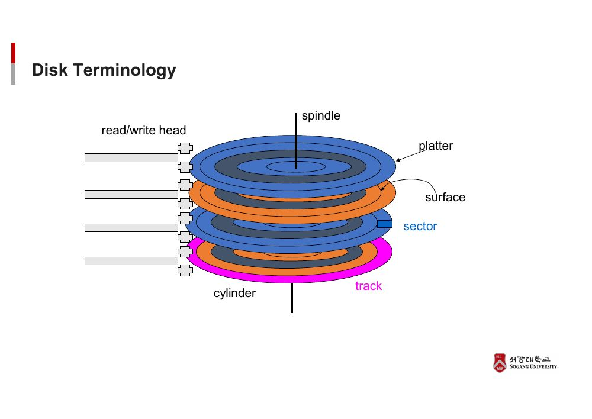<br/><sub>📄 강의자료 ① p.13 Disk Terminology</sub></p>

### 1.2 🔥 강의 대표 예제 — 반드시 손으로 재현할 것

| | Cheetah | Barracuda |
|---|---|---|
| RPM / 평균 seek / 최대 전송률 | 15,000 / 4 ms / 125 MB/s | 7,200 / 9 ms / 105 MB/s |
| **회전** | ½ × 60,000/15,000 = **2 ms** | ½ × 60,000/7,200 ≈ **4.1 ms** |
| **전송** (16 KB) | 16 KB ÷ 125 MB/s = **125 µs** | 16 KB ÷ 105 MB/s ≈ **149 µs** |
| **T_I/O** | 4 + 2 + 0.125 ≈ **6.1 ms** | 9 + 4.1 + 0.149 ≈ **13.2 ms** |
| **랜덤 대역폭** | 16 KB ÷ 6.1 ms ≈ **2.5 MB/s** | 16 KB ÷ 13.2 ms ≈ **1.2 MB/s** |
| **순차 대역폭** | **125 MB/s** | **105 MB/s** |

> 🔥 **결론**: 랜덤은 seek와 rotation이 시간을 다 먹어서 **순차보다 50~90배 느리다.**

<p align="center">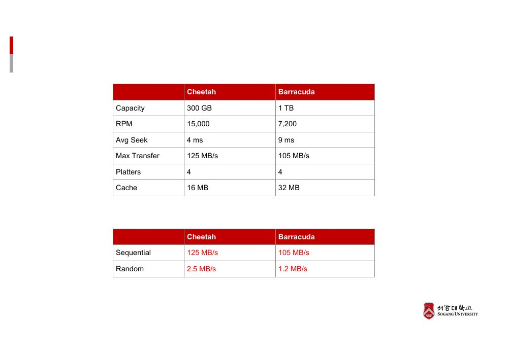<br/><sub>📄 강의자료 ① p.47 순차 vs 랜덤 결과</sub></p>

### 1.3 연습 문제

**Q1. (랜덤 읽기)** 디스크가 **10,000 RPM**, 평균 seek **5 ms**, 최대 전송률 **100 MB/s**이다. (a) **4 KB** 랜덤 읽기 1회 시간, (b) 랜덤 읽기 대역폭, (c) IOPS를 구하라.
<sub>🇬🇧 A disk spins at 10,000 RPM. The average seek time is 5 ms and the maximum transfer rate is 100 MB/s. Calculate the time for one random 4 KB read, the random read bandwidth, and IOPS.</sub>

<details>
<summary>▶ 답</summary>

```
(a) Seek       = 5 ms
    Rotation   = ½ × 60,000 / 10,000 = 3 ms
    Transfer   = 4 KB ÷ 100 MB/s = 4 ÷ (100 × 1024) s ≈ 0.04 ms (39 µs)
    T_I/O      ≈ 5 + 3 + 0.04 = 8.04 ms
(b) Bandwidth  = 4 KB ÷ 8.04 ms ≈ 497 KB/s ≈ 0.49 MB/s
(c) IOPS       = 1000 ÷ 8.04 ≈ 124
```
seek와 rotation이 시간의 99%를 차지하고, 전송 시간은 거의 0이다.
</details>

**Q2. (순차 읽기)** 같은 디스크에 연속으로 저장된 **10 MB** 파일을 통째로 읽는 시간과 실효 대역폭은? Q1과 비교하라.
<sub>🇬🇧 On the same disk, a 10 MB file is stored contiguously. Calculate the time to read the whole file and the effective bandwidth. Compare with Q1.</sub>

<details>
<summary>▶ 답</summary>

```
Seek       = 5 ms       (처음 한 번만)
Rotation   = 3 ms       (처음 한 번만)
Transfer   = 10 MB ÷ 100 MB/s = 100 ms
Total      = 108 ms
Bandwidth  = 10 MB ÷ 0.108 s ≈ 92.6 MB/s
```
순차는 seek·rotation을 **한 번만** 내므로 랜덤 4 KB(0.49 MB/s)보다 약 **190배** 빠르다. 파일이 클수록 최대 전송률(100 MB/s)에 가까워진다.
</details>

**Q3. (쓰기)** Q1에서 4 KB **랜덤 쓰기**는 읽기와 시간이 다른가? 디스크가 **write caching(immediate reporting)**을 쓰면?
<sub>🇬🇧 Is a random 4 KB write different from a random read in Q1? What if the disk uses write caching with immediate reporting?</sub>

<details>
<summary>▶ 답</summary>

- 캐시가 없으면 쓰기도 seek + rotation + transfer → **약 8.04 ms로 같다.**
- immediate reporting이면 데이터가 **디스크 DRAM에 들어가자마자 "다 썼다"고 응답** → 호스트가 보는 **응답 시간은 매우 짧다.**
- ⚠️ 하지만 아직 platter에 안 써졌으므로 **정전 시 데이터 손실** 위험.
</details>

**Q4. (응답 시간과 스케줄링)** 요청 6개가 동시에 도착했다: `300001, 700001, 300002, 700002, 300003, 700003`. 멀리 점프(seek+rotation)는 **10 ms**, 바로 옆 sector는 **≈0 ms**로 가정한다. (a) 도착 순서대로(FCFS), (b) 정렬해서 처리할 때 총 시간과 **평균 응답 시간**은?
<sub>🇬🇧 Six requests arrive at the same time. Assume a far jump costs 10 ms and a neighboring request costs ≈0 ms. Calculate the total time and average response time for (a) FCFS and (b) the sorted order.</sub>

<details>
<summary>▶ 답</summary>

```
(a) FCFS: 매번 멀리 점프 → 완료 시각 10, 20, 30, 40, 50, 60 ms
    총 시간 = 60 ms,  평균 응답 = (10+20+30+40+50+60) ÷ 6 = 35 ms

(b) 정렬: 300001, 300002, 300003, 700001, 700002, 700003
    점프 2번 → 완료 시각 10, 10, 10, 20, 20, 20 ms
    총 시간 = 20 ms,  평균 응답 = (10×3 + 20×3) ÷ 6 = 15 ms
```
순서만 바꿔도 **3배** 빨라진다 → 이것이 디스크의 **command queuing(TCQ/NCQ)**.

> 강의자료는 총 시간(~60 ms → ~20 ms)까지만 다뤘고, 평균 응답 시간은 같은 가정으로 확장한 계산입니다.
</details>

**Q5. (track 구조로 전송률 구하기)** track 하나에 **512 B sector 500개**, **7,200 RPM**이다. (a) sector 1개 전송 시간, (b) 최대 전송률, (c) 바깥 zone은 track당 **1,000 sector**일 때 전송률은?
<sub>🇬🇧 A track has 500 sectors of 512 B, and the disk spins at 7,200 RPM. Find the transfer time of one sector, the maximum transfer rate, and the rate of an outer zone with 1,000 sectors per track.</sub>

<details>
<summary>▶ 답</summary>

```
1회전           = 60,000 ÷ 7,200 ≈ 8.33 ms
(a) sector 1개  = 8.33 ms ÷ 500 ≈ 0.0167 ms (16.7 µs)
(b) 전송률      = (500 × 512 B) ÷ 8.33 ms ≈ 30.7 MB/s   (1 MB = 10⁶ B)
(c) 바깥 zone   = (1,000 × 512 B) ÷ 8.33 ms ≈ 61.4 MB/s  → 2배
```
RPM은 일정하므로 sector가 많은 track일수록 초당 더 많은 데이터가 지나간다 → **ZBR에서 바깥 zone이 더 빠른 이유.**
</details>

**Q6. (응용: track skew)** Q5 디스크에서 옆 track으로 이동 + settle에 **1 ms**가 걸린다. track skew는 최소 몇 sector여야 하나?
<sub>🇬🇧 Moving the head to the next track and settling takes 1 ms. How many sectors should the track skew be at least?</sub>

<details>
<summary>▶ 답</summary>

```
sector 1개 = 0.0167 ms  →  1 ms ÷ 0.0167 ms ≈ 60 sector  →  skew ≥ 60 sector
```
1 ms 동안 약 60 sector가 헤드 밑을 지나가므로, 다음 track 시작 위치를 60 sector 이상 밀어 두면 한 바퀴를 기다리지 않는다.

> 강의는 track skew 개념만 다뤘고, 이 숫자 계산은 개념 확인용 응용입니다.
</details>

**Q7. (비교)** Cheetah와 Barracuda 중 (a) 16 KB 랜덤 읽기 DB, (b) 대용량 동영상 백업에는 각각 어느 것이 나은가?
<sub>🇬🇧 Which disk is better for (a) a database with random 16 KB reads, (b) storing large video backups? Justify.</sub>

<details>
<summary>▶ 답</summary>

- (a) **Cheetah**: 랜덤 2.5 MB/s vs 1.2 MB/s (약 2배). seek(4 vs 9 ms)와 회전(2 vs 4.1 ms)이 짧다.
- (b) **Barracuda**: 순차라서 전송률 차이가 작고(125 vs 105 MB/s), 용량이 크다(1 TB vs 300 GB).
</details>

**Q8. (요청 크기와 랜덤 대역폭)** **7,200 RPM**, 평균 seek **8 ms**, 최대 전송률 **200 MB/s**인 디스크에서 랜덤 읽기 요청 크기가 (a) **4 KB**, (b) **64 KB**일 때 대역폭을 각각 구하라. 무엇을 알 수 있나?
<sub>🇬🇧 A disk: 7,200 RPM, 8 ms average seek, 200 MB/s. Calculate the random read bandwidth for 4 KB and 64 KB requests.</sub>

<details>
<summary>▶ 답</summary>

```
Rotation = ½ × 60,000 / 7,200 ≈ 4.17 ms          (공통)

(a) 4 KB : Transfer = 4 ÷ (200 × 1024) s ≈ 0.02 ms
           T = 8 + 4.17 + 0.02 ≈ 12.19 ms
           BW = 4 KB ÷ 12.19 ms ≈ 328 KB/s ≈ 0.32 MB/s

(b) 64 KB: Transfer = 64 ÷ (200 × 1024) s ≈ 0.31 ms
           T = 8 + 4.17 + 0.31 ≈ 12.48 ms
           BW = 64 KB ÷ 12.48 ms ≈ 5,128 KB/s ≈ 5.0 MB/s
```
요청 시간은 거의 같은데(seek+rotation이 고정비) 한 번에 옮기는 양이 16배라 **대역폭이 약 16배**. → 랜덤이라도 **요청을 크게 묶을수록** HDD에 유리 (작은 파일을 큰 파일로 묶는 TFRecord·WebDataset 같은 기법의 이유).
</details>

<br/>

---

## 블록 2. HDD 내부 최적화 기법/기술 (15분) 🔥

> 📄 강의자료 ① p.15 (Positioning), p.48~66 (Other Improvements, I/O Schedulers), p.67~72 (Trends)

### 2.1 ⭐ 강의자료의 "Other Improvements" 3종 — 무조건 나온다

```
                   ┌─ ① Track Skew  : 순차 읽기에서 다음 track으로 넘어갈 때 시간을 벌어줌
Other Improvements ┼─ ② Zones (ZBR) : 바깥 track에 sector를 더 많이
                   └─ ③ Cache       : Read-ahead / Write caching / TCQ
```

#### ① Track Skew 🔥
- **문제**: 15번(안쪽 track 끝)을 읽고 16번(바깥 track 시작)을 읽으려는데, 헤드가 이동해서 **settle하는 동안 16번이 지나가 버림** → **거의 한 바퀴를 다시 기다림**
  - 강의자료: *"When reading 16 after 15, the head won't settle quick enough, so we need to do a rotation."*
- **해결**: 인접 track의 sector 번호 시작 위치를 **어긋나게(skew)** 배치 → *"enough time to settle now"*
- 핵심: **arm 이동 시간 + platter 회전 시간을 함께 고려**한 배치

```
skew 없음:  track A ... 14 [15] → (이동·settle 중에 16이 지나감) → 한 바퀴 대기 → [16]
skew 있음:  track A ... 14 [15] → (이동·settle) → 딱 도착했을 때 [16]이 옴
```

<p align="center">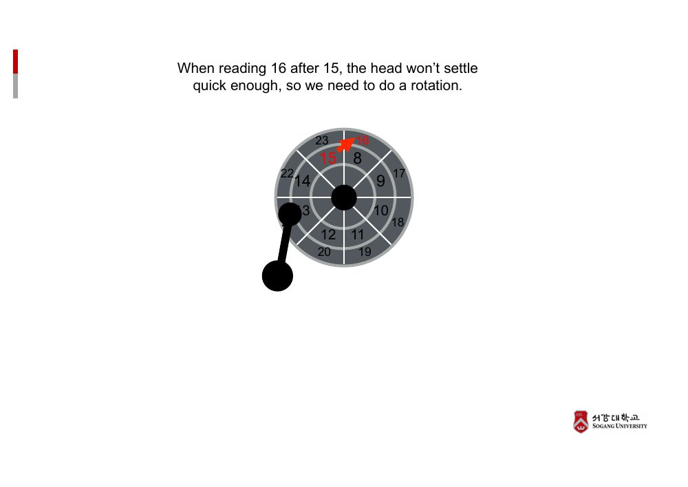 <br/><sub>📄 강의자료 ① p.50 (문제: 16번을 놓침) → p.52 (skew 적용: enough time to settle)</sub></p>

#### ② Zones (ZBR, Zoned Bit Recording) 🔥
- **문제**: 바깥 track이 안쪽보다 **둘레가 긴데** sector 수가 같으면 공간 낭비
- **해결**: **바깥 track에 sector를 더 많이** 배치. 같은 zone 안의 track은 sector 수가 같음
- **결과**: RPM이 일정하므로 **바깥 zone의 순차 전송률이 더 높다**
  - 강의자료 필기: "track이 커지면 모두 읽어야 함" → zones

<p align="center">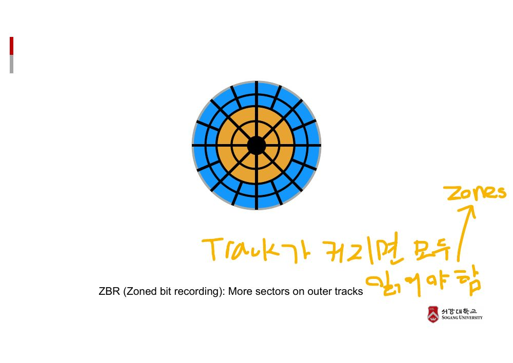<br/><sub>📄 강의자료 ① p.57 ZBR: More sectors on outer tracks</sub></p>

#### ③ Drive Cache / Buffering 🔥
디스크 안에 **2 MB~16 MB 메모리**가 캐시로 들어 있다 (OS도 따로 캐싱함).

| 기법 | 동작 | 장점 | ⚠️ 주의 |
|---|---|---|---|
| **Read-ahead ("Track buffer")** | **회전 대기 동안 track 전체**를 메모리에 읽어 둠 | 다음 읽기가 캐시에서 바로 | — |
| **Write caching (immediate reporting / write-back)** | DRAM에 넣자마자 "다 썼다"고 응답, 나중에 platter에 기록 | 쓰기 응답이 매우 빠름 | **정전 시 데이터 손실** → FS/DB **consistency 깨짐** |
| **Tagged Command Queueing (TCQ)** | 여러 요청을 동시에 디스크에 걸어 두면 **디스크가 순서를 재배치** | seek·회전 최소화 (60 → 20 ms) | SATA에서는 **NCQ** |

- **Striping과 Jitter** (강의자료 필기): 여러 디스크에 쪼개 저장(striping)하면, 디스크마다 write-back 상태가 달라 **가장 느린 디스크**를 기다려야 함 → 응답 시간 편차(**jitter**) → tail latency↑

<p align="center">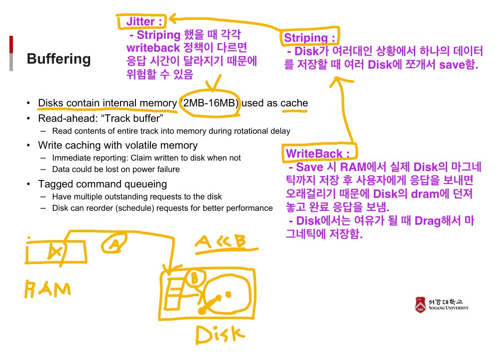<br/><sub>📄 강의자료 ① p.60 Buffering (WriteBack · Striping · Jitter 필기)</sub></p>

### 2.2 Positioning (Servo)
- **문제**: 헤드는 자기 위치를 어떻게 아나? platter가 완벽히 정렬되지 않고 track이 완벽한 원이 아님(**runout**). 밀도(BPI, TPI)가 높을수록 더 어려움
- **해결**: **Servo burst** — **3~5 sector마다 위치 정보**를 기록 → 헤드가 지나가며 위치 보정

### 2.3 I/O 스케줄링 🔥

> 강의자료: *"Position of disk head relative to request position matters more than length of job"* — CPU 스케줄링과 달리 **작업 길이보다 헤드 위치**가 중요

| 스케줄러 | 기준 | 어디서? | Starvation | 특징 |
|---|---|---|---|---|
| FCFS | 도착 순서 | 어디든 | 없음 | 위치 무시 → 비효율 |
| **SPTF** | **seek + rotation** 최소 (greedy) | **디스크** | ⚠️ **있음** | 회전 위치를 알아야 함 |
| **SSTF** | **seek**만 최소 | **OS** | ⚠️ **있음** | OS용 SPTF 대체품 |
| SCAN (elevator) | 끝↔끝 **왕복** | OS | 없음 | **가운데 cylinder 유리**, 회전 무시 |
| C-SCAN | **한 방향**으로만, 끝나면 처음으로 | OS | 없음 | SCAN보다 **공정(fair)** |

> 🔥 **단골: 왜 OS는 SPTF를 못 하나?** → OS는 **논리 주소(LBA)만** 알고, 헤드의 **회전 위치**는 디스크만 안다. 그래서 OS는 **SSTF**를 쓴다.

**Bad sector 재매핑** (강의자료 필기): bad sector가 생겨도 **spare sector로 재매핑** → OS가 보는 용량·`df` 크기는 **변하지 않음**. spare가 다 떨어지면 I/O 오류가 나거나 FS가 그 블록을 안 쓰게 되어 실질 가용 용량이 줄어듦.

<p align="center">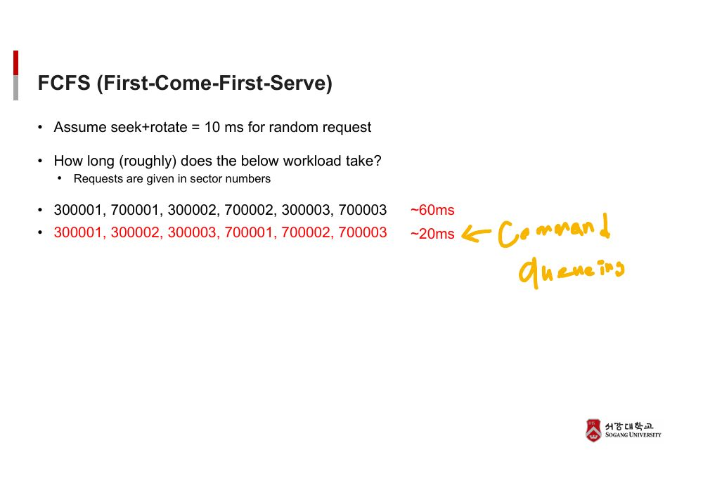<br/><sub>📄 강의자료 ① p.63 FCFS 60 ms → 20 ms (Command queuing)</sub></p>

### 2.4 HDD 신기술 (용량·신뢰성)

| 기술 | 원리 | 장점 | 단점 / 용도 |
|---|---|---|---|
| **Helium drive** | 공기 대신 헬륨 → 마찰↓ | ① 더 얇은 platter ② 진동↓ → 고장↓ ③ 더 많이 적층 → 용량↑ | (He12: 용량 +50%, 전력 −54%, 신뢰성 +25%) |
| **HAMR** (Seagate) | **레이저로 순간 가열** 후 기록 | **가장 높은 밀도** | 제조 난도·발열·내구성·비용 |
| **MAMR** (WD) | **마이크로파**(STO)로 자화 반전 보조 | 레이저 불필요, **기존 공정 호환** | 최대 밀도 < HAMR |
| **SMR** | track을 **기와처럼 겹침** | 싸고 대용량 | zone 안에서 **순차 쓰기만** → 랜덤 쓰기 느림 → 백업·아카이브(**WORM**) |

- 자성 입자를 무작정 작게 못 하는 이유: **열적 불안정성** → HAMR/MAMR로 우회
- **HDD는 죽지 않았다**: GB당 싸서 데이터센터 PB~EB급 저장에 여전히 사용 (CERN EOS: 900 서버, 70k HDD)

### 2.5 연습 문제

**Q1.** track skew가 해결하는 문제를 예를 들어 설명하라.
<sub>🇬🇧 What problem does track skew solve? Explain with an example.</sub>

<details>
<summary>▶ 답</summary>

15번(track 끝) → 16번(다음 track 시작)을 순차로 읽을 때, 헤드가 다음 track으로 이동해 settle하는 동안 16번이 지나가 버려 **거의 한 바퀴를 기다린다.** track skew는 다음 track의 시작 위치를 밀어 **settle할 시간을 벌어 준다.**
</details>

**Q2.** 왜 바깥 zone이 안쪽보다 전송률이 높은가?
<sub>🇬🇧 Why do outer zones have a higher transfer rate than inner zones?</sub>

<details>
<summary>▶ 답</summary>

ZBR은 더 긴 바깥 track에 sector를 더 많이 둔다. RPM은 같으므로 바깥 track에서 **초당 더 많은 sector가 지나간다.**
</details>

**Q3.** 🔥 immediate reporting(write caching)의 위험을 설명하라.
<sub>🇬🇧 Explain the risk of write caching with immediate reporting.</sub>

<details>
<summary>▶ 답</summary>

데이터가 **휘발성 DRAM에만 있는데 "다 썼다"고 보고**한다. 정전되면 저장됐다고 들은 데이터가 사라져 **FS/DB의 일관성(consistency)이 깨진다.**
</details>

**Q4.** 🔥 OS는 왜 SPTF를 구현하지 못하나? 대신 무엇을 쓰나?
<sub>🇬🇧 Why can the OS not implement SPTF? What does it use instead?</sub>

<details>
<summary>▶ 답</summary>

SPTF는 헤드의 **회전 위치**가 필요한데, OS는 **LBA만** 안다. 회전 위치는 디스크만 알기 때문에 OS는 seek 거리만 보는 **SSTF**를 쓴다.
</details>

**Q5.** TCQ가 무엇이고 왜 성능을 높이나?
<sub>🇬🇧 What is tagged command queueing and why does it improve performance?</sub>

<details>
<summary>▶ 답</summary>

여러 요청을 한꺼번에 디스크에 걸어 두면, 헤드 위치를 아는 디스크가 **seek·회전이 최소가 되도록 순서를 재배치**한다. 강의 예: 60 ms → 20 ms.
</details>

**Q6.** SMR이 아카이브에는 좋고 랜덤 쓰기에는 나쁜 이유는?
<sub>🇬🇧 Why is SMR good for archives but bad for random writes?</sub>

<details>
<summary>▶ 답</summary>

track을 기와처럼 겹쳐서 한 track을 쓰면 옆 track 일부를 덮는다 → **zone 안에서는 순차 쓰기만** 가능. 랜덤 쓰기는 재기록이 필요해 느리다. 아카이브(WORM)는 대부분 순차라 잘 맞는다.
</details>

<br/>

---

## 블록 3. RAID — 비교 분석 (35분) 🔥

> 📄 강의자료 ③ p.13 (Metrics), p.18~23, p.46~54 (분석·비교표 — **"계산 시험" 별표**), p.55~56 (RAID-6)

### 3.1 핵심 개념

- **RAID** = 여러 개의 싼 디스크를 묶어 **하나의 크고 빠르고 안 죽는 가짜 논리 디스크(fake logical disk)**로 보여줌
  - **Transparent**(위 계층은 모름) / **Deployable**(그대로 꽂아 씀)
- 도구 2개: **Mapping(striping)** → 용량·성능 / **Redundancy(mirror, parity)** → 신뢰성
- ⭐ **RAID = static mapping**(간단한 수식) ↔ **SSD FTL = dynamic mapping**(표) ← 블록 5와 연결
- **Fail-stop 모델**: 디스크는 **정상 아니면 완전 고장**, 시스템은 **어느 디스크가 죽었는지 안다**
  - 못 잡는 에러(Tougher errors): **latent sector error**, **silent data corruption**
- **JBOD**: 디스크마다 FS 따로, 애플리케이션이 알아서 관리. redundancy 없음

**강의자료 개념 더 보기 (T/F 대비)**
- **왜 여러 디스크?** capacity, reliability, performance. 문제는 **대부분의 FS가 디스크 1개에서만 동작**한다는 것 → JBOD 또는 RAID
- **RAID = Redundant Array of Inexpensive Disks** — 왜 *Inexpensive*? **규모의 경제**: 싼 commodity 디스크 여러 개 + 소프트웨어 = 고품질 논리 장치. (대안: 비싼 고급 디스크 1개)
- **Mapping 전략**: 작은 디스크로 크고 빠른 디스크 만들기 / **Redundancy 전략**: 디스크를 더 붙여 신뢰성
- **Redundancy trade-off**: 복사본↑ → **신뢰성↑ (경우에 따라 성능도↑**, 병렬 읽기) / 복사본↓ (**deduplication**) → **공간 효율↑**
  - Dedup: 블록 내용을 해시(SHA-1)로 **fingerprint**를 만들어 같으면 1개만 저장. 예: `fp(100) == fp(200)` → 같은 내용
  - 필기: 실무 redundancy는 보통 **copy 3개**까지
- **RAID 결정 사항**: 어떤 논리 block → 어떤 물리 block? 남는 물리 block을 어떻게 쓰나? → RAID level마다 trade-off가 다름
- **Workload**: read/write × **one operation**(→ latency로 측정) / **steady-state I/O**(→ throughput, sequential·random)
- **Metric**: Capacity(앱이 쓸 수 있는 공간) / Reliability(몇 개까지 잃어도 되나, **fail-stop 가정**) / Performance(**디스크 1개 특성으로 정규화**)
- **HDD/SSD Array 장점**: Performance(병렬 접근), Scalability(확장 쉬움), Reliability(RAID), Efficiency(IOPS·대역폭 활용)
- **Parallel File System (Lustre)**: 데이터는 여러 OST에 분산되지만 메타데이터는 **MDS/MDT로 몰림** → **Metadata Server Bottleneck** (작은 파일이 많은 AI 학습에 치명적). DNE로 MDT를 늘려 완화

### 3.2 기호 (⭐ 반드시 암기)

| 기호 | 뜻 |
|---|---|
| **N** | 디스크 수 |
| **C** | 디스크 1개 용량 |
| **S** | 디스크 1개 **순차** 처리량 |
| **R** | 디스크 1개 **랜덤** 처리량 |
| **D** | 작은 I/O 1개 **지연시간** |

### 3.3 🔥⭐ 최종 비교표 (강의자료에 "계산 시험" 별표)

| | 용량 | 신뢰성 | 읽기 지연 | 쓰기 지연 | 순차 읽기 | 순차 쓰기 | 랜덤 읽기 | 랜덤 쓰기 |
|---|---|---|---|---|---|---|---|---|
| **RAID-0** | N·C | **0** | D | D | N·S | N·S | N·R | N·R |
| **RAID-1** | (N/2)·C | **1** (운 좋으면 N/2) | D | D | (N/2)·S | (N/2)·S | **N·R** | **(N/2)·R** |
| **RAID-4** | (N−1)·C | 1 | D | **2D** | (N−1)·S | (N−1)·S | (N−1)·R | **R/2** ⚠️ |
| **RAID-5** | (N−1)·C | 1 | D | **2D** | (N−1)·S | (N−1)·S | **N·R** | **N·R/4** |
| **RAID-6** | (N−2)·C | **2** | | | | | | |

> 🔥 **강의자료 결론 3줄 (서술형 단골)**
> 1. **RAID-0** is always fastest and has best capacity (but at cost of reliability) — 가장 빠르고 용량 최대, 대신 신뢰성 0
> 2. **RAID-5 better than RAID-1 for sequential workloads** — 순차는 RAID-5
> 3. **RAID-1 better than RAID-5 for random workloads** — 랜덤은 RAID-1
> + **RAID-5 is strictly better than RAID-4** — RAID-5가 RAID-4보다 모든 면에서 같거나 낫다

<p align="center">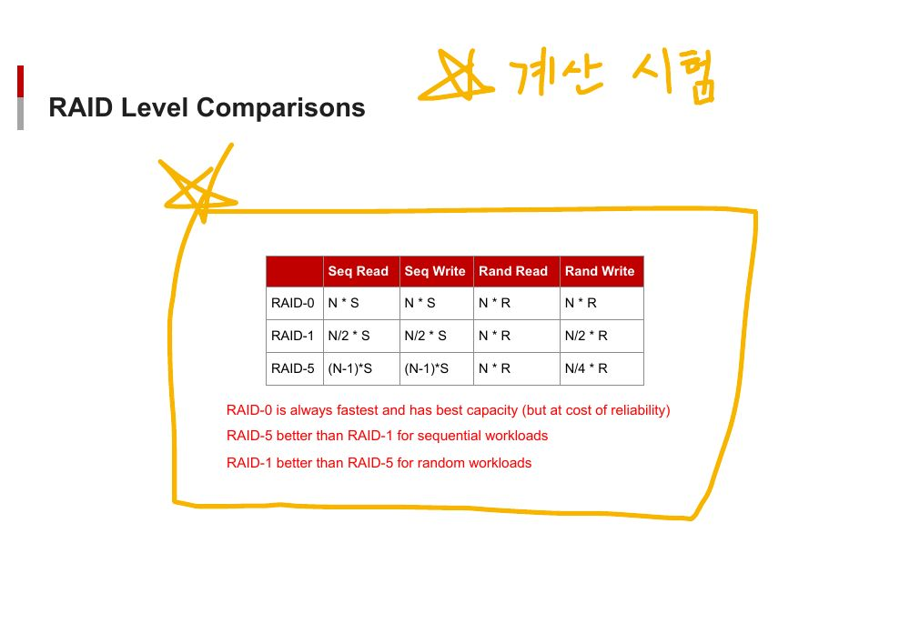<br/><sub>📄 강의자료 ③ p.54 — ★ 계산 시험 표시</sub></p>

### 3.4 표를 외우지 말고 "유도"하는 3원리

1. **일하는 디스크 수를 센다** → 읽기 계수
   - RAID-1 랜덤 읽기: 아무 복사본이나 읽음 → **N**
   - RAID-4: parity 디스크는 데이터가 없음 → **N−1**
   - RAID-5: parity가 흩어져 있어 모든 디스크가 일함 → **N**
2. **논리 쓰기 1개 = 물리 I/O 몇 개?** → 쓰기 분모
   - RAID-1: 복사본 2개 쓰기 → **÷2**
   - RAID-5 랜덤 쓰기: **4개** → **÷4**
   - RAID-4: 4개 중 2개가 **parity 디스크 1개**에 몰림 → **R/2**
3. **지연시간은 N과 무관.** parity 갱신은 읽고 → 쓰기 왕복 → **2D**

> ⭐ **"Buying more disks improves throughput, but not latency!"** (강의자료 빨간 글씨) — 디스크를 늘려도 요청 하나의 시간은 여전히 D
>
> ⚠️ **RAID-1 순차 읽기가 N·S가 아니라 (N/2)·S인 이유**: 한 디스크가 0, 2, 4, 6을 읽으면 1, 3, 5, 7 자리를 **건너뛰며 회전**해야 해서 디스크당 S/2. (강의자료: *Book: N/2·S, other models: N·S*)

### 3.5 Parity(XOR)와 Small-write 문제 🔥

```
P       = D0 ⊕ D1 ⊕ D2 ⊕ ...            (XOR: 같으면 0, 다르면 1)
복구     = 나머지 전부 XOR (P 포함)
P_new   = P_old ⊕ D_old ⊕ D_new         (subtractive parity)
물리 I/O = read D_old, read P_old, write D_new, write P_new  → 4개 (N과 무관)
지연     = 2D (읽기 2개 병렬 + 쓰기 2개 병렬)
```

- 강의자료는 이해용으로 **덧셈 parity** 예제를 썼음: `5 3 0 1 | 9` → 하나가 X면 `9 − 나머지 합`. 실제는 **XOR**
- **RAID-4**: 모든 small write가 **하나뿐인 parity 디스크**를 2번(읽기+쓰기) 건드림 → **병목** → **R/2, N을 늘려도 그대로**
- **RAID-5**: parity를 디스크마다 **돌아가며(rotate)** 배치 → 부하 분산 → **N·R/4**
- **RAID-6**: parity **2개**를 rotate. P = **XOR**, Q = **Reed-Solomon** (둘 다 XOR이면 같은 방정식 2개라 미지수 2개를 못 품)
  - 강의 예: **10 디스크, 8+2**, stripe unit **128 KiB** → full stripe = 128 KiB × 8 = **1 MB**, 용량 오버헤드 **20%**

<p align="center">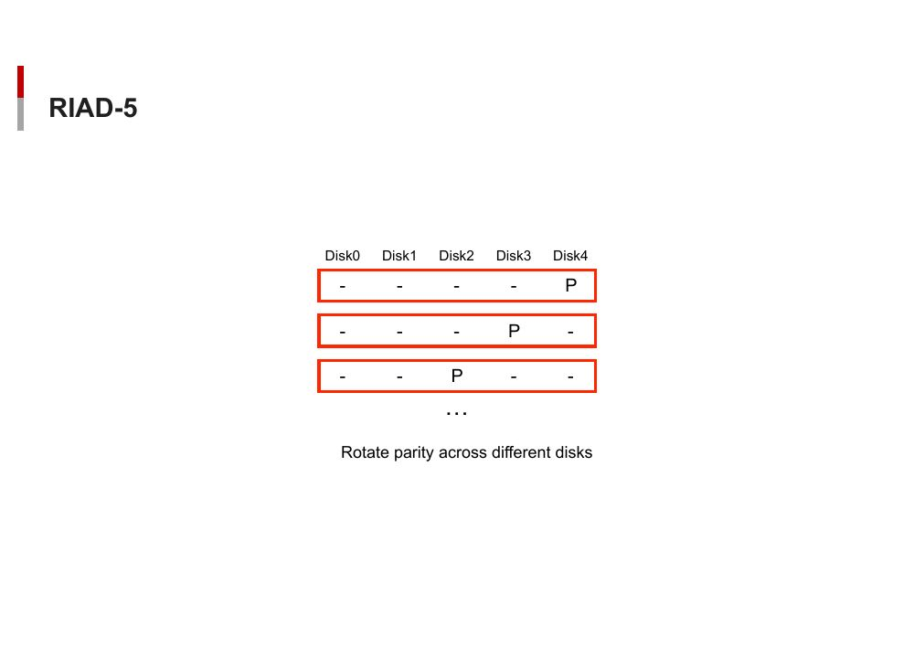<br/><sub>📄 강의자료 ③ p.48 RAID-5: Rotate parity across different disks</sub></p>

### 3.6 🔥 비교 분석 — "어떤 상황에 무엇을?"

| Level | 장점 | 단점 | 이럴 때 쓴다 |
|---|---|---|---|
| **RAID-0** | 가장 빠름, 용량 100% | **신뢰성 0** — 1개만 죽어도 전부 손실 | 다시 만들 수 있는 임시·캐시 데이터 |
| **RAID-1** | 랜덤 쓰기 최강 (**RAID-5의 2배**), 단순 | 용량 **50%** | **랜덤 쓰기가 많은 DB (OLTP)** |
| **RAID-4** | 용량 (N−1)/N | **parity 디스크 병목** → 랜덤 쓰기 R/2 | 실무에서 거의 안 씀 |
| **RAID-5** | 용량 (N−1)/N, 순차 좋음 | small write 4 I/O, 쓰기 지연 2D | **순차 읽기 위주 + 용량 중요** (AI 학습 데이터) |
| **RAID-6** | **디스크 2개** 고장 허용 | 용량 (N−2)/N, 쓰기 더 비쌈 | **대용량 디스크** (rebuild가 길어서) |

- **용량 효율**: RAID-1 = 50%, RAID-5 = (N−1)/N, RAID-6 = (N−2)/N
- **Consistent-update problem (RAID-1)**: 한쪽만 쓰고 crash → 어느 쪽이 맞는지 모름 → **H/W RAID는 NVRAM**으로 해결, **S/W RAID(Linux md)는 이 방법을 못 씀**
- **RAID-0 매핑**: chunk 1 → `Disk = A % N`, `Offset = A / N` / chunk k → `Disk = (A/k) % N`, `Offset = (A/(k·N))·k + A%k`

<p align="center">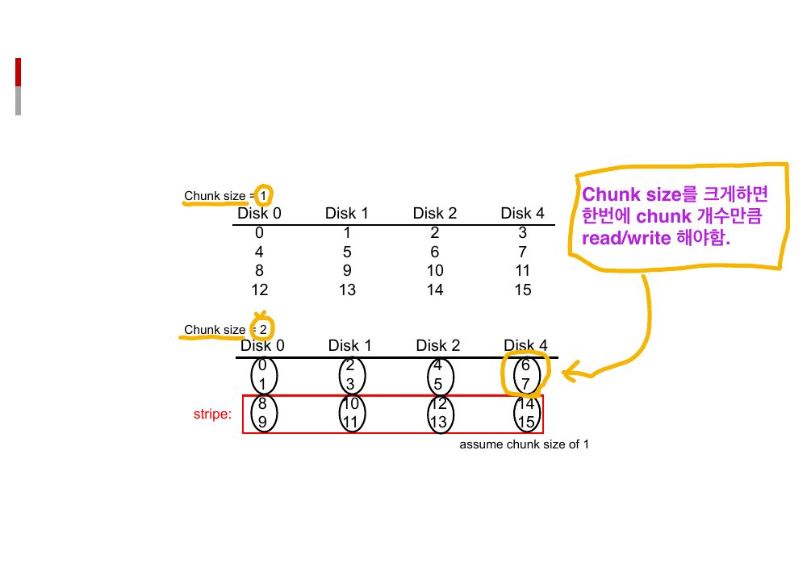 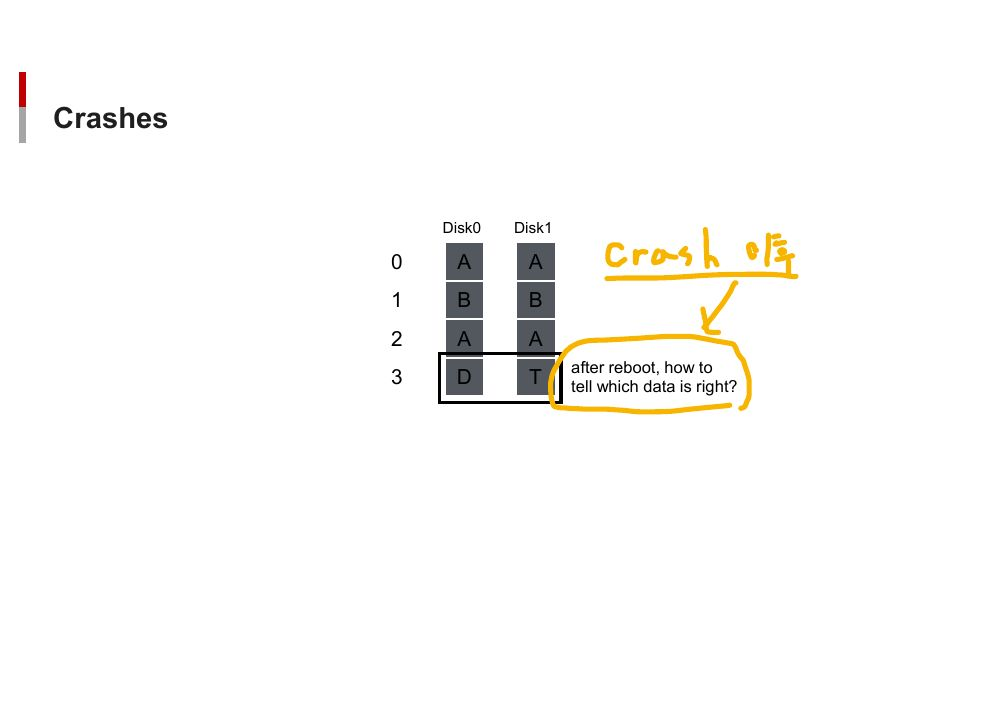<br/><sub>📄 강의자료 ③ p.17 chunk size 1 vs 2 / p.32 RAID-1 crash (어느 쪽이 맞나?)</sub></p>

### 3.7 연습 문제

공통 조건: **N = 8, C = 2 TB, S = 150 MB/s, R = 100 IOPS, D = 8 ms**

**Q1. 🔥 (전체 비교)** RAID-0/1/4/5의 용량, 신뢰성, 쓰기 지연, 순차 읽기, 랜덤 읽기, 랜덤 쓰기를 채워라.
<sub>🇬🇧 Fill in the table for RAID-0, 1, 4, 5: capacity, reliability, write latency, sequential read, random read, random write.</sub>

<details>
<summary>▶ 답</summary>

| | 용량 | 신뢰성 | 쓰기 지연 | 순차 읽기 | 랜덤 읽기 | 랜덤 쓰기 |
|---|---|---|---|---|---|---|
| RAID-0 | 16 TB | 0 | 8 ms | 1,200 MB/s | 800 IOPS | 800 IOPS |
| RAID-1 | 8 TB | 1 (최대 4) | 8 ms | 600 MB/s | 800 IOPS | 400 IOPS |
| RAID-4 | 14 TB | 1 | 16 ms | 1,050 MB/s | 700 IOPS | **50 IOPS** |
| RAID-5 | 14 TB | 1 | 16 ms | 1,050 MB/s | 800 IOPS | **200 IOPS** |
| (RAID-6) | 12 TB | 2 | | | | |
</details>

**Q2. 🔥 (OLTP)** 랜덤 쓰기 위주 DB에는 RAID-1과 RAID-5 중 무엇이 나은가? 숫자로 근거를 대고 trade-off를 말하라.
<sub>🇬🇧 A database performs mostly random writes. Which is better, RAID-1 or RAID-5? Justify with numbers and mention the trade-off.</sub>

<details>
<summary>▶ 답</summary>

**RAID-1.** 랜덤 쓰기: RAID-1 = (N/2)·R = **400 IOPS**, RAID-5 = N·R/4 = **200 IOPS** → 2배.
RAID-1은 논리 쓰기 1개 = 물리 쓰기 **2개**, RAID-5는 물리 I/O **4개**(old data 읽기, old parity 읽기, new data 쓰기, new parity 쓰기).
**Trade-off**: 용량은 RAID-5가 큼 (14 TB vs 8 TB).
</details>

**Q3. (AI 학습 데이터)** GPU 클러스터가 대용량 학습 데이터를 순차로 읽는다. RAID-1과 RAID-5 중 무엇이 나은가?
<sub>🇬🇧 A GPU cluster reads a large training dataset sequentially. RAID-1 or RAID-5?</sub>

<details>
<summary>▶ 답</summary>

**RAID-5.** 순차 읽기: RAID-5 = (N−1)·S = **1,050 MB/s**, RAID-1 = (N/2)·S = **600 MB/s**. 용량도 RAID-5가 큼.
</details>

**Q4. 🔥 (확장성)** N을 8 → 16으로 늘리면 RAID-4와 RAID-5의 랜덤 쓰기는 어떻게 변하나? 이유는?
<sub>🇬🇧 We double N from 8 to 16. How does the random write throughput of RAID-4 and RAID-5 change? Why?</sub>

<details>
<summary>▶ 답</summary>

```
RAID-4: R/2 = 50 IOPS → 50 IOPS          (그대로!)
RAID-5: N·R/4 = 200 → 16 × 100 ÷ 4 = 400 IOPS   (2배)
```
RAID-4는 모든 small write가 **단일 parity 디스크**를 거쳐 N과 무관하게 병목. RAID-5는 parity를 **rotate**해서 N에 비례.
</details>

**Q5. ⚠️ (지연 vs 처리량)** RAID-5 small write는 물리 I/O가 4개인데 왜 지연이 4D가 아니라 2D인가?
<sub>🇬🇧 In RAID-5, one small write needs 4 physical I/Os. Why is the latency 2D, not 4D?</sub>

<details>
<summary>▶ 답</summary>

읽기 2개(old data, old parity)는 **서로 다른 디스크라 동시에** 진행(D), 쓰기 2개도 동시에(D) → **2D = 16 ms**. 처리량은 총 I/O 개수 4개로 나누므로 N·R/4.
</details>

**Q6. (매핑)** 디스크 **4개**, chunk **2**인 RAID-0에서 논리 블록 **13**은 어디에?
<sub>🇬🇧 RAID-0 with 4 disks and chunk size 2. Where is logical block 13?</sub>

<details>
<summary>▶ 답</summary>

```
Disk   = (13 / 2) % 4 = 6 % 4 = 2
Offset = (13 / 8) × 2 + (13 % 2) = 1 × 2 + 1 = 3      → Disk 2, offset 3
검산: D0: 0,1 | 8,9   D1: 2,3 | 10,11   D2: 4,5 | 12,13   D3: 6,7 | 14,15  ✓
```
</details>

**Q7. (XOR)** RAID-4에서 D0 = 0110, D1 = 1011, D2 = 0101. (a) P를 구하라. (b) Disk 2가 고장났다. D2를 복구하라. (c) D0이 1111로 바뀌면 subtractive parity로 새 P는?
<sub>🇬🇧 (a) Compute P. (b) Recover D2. (c) D0 is updated to 1111; compute P_new with subtractive parity.</sub>

<details>
<summary>▶ 답</summary>

```
(a) P     = 0110 ⊕ 1011 ⊕ 0101 = 1101 ⊕ 0101 = 1000
(b) D2    = D0 ⊕ D1 ⊕ P = 0110 ⊕ 1011 ⊕ 1000 = 1101 ⊕ 1000 = 0101  ✓
(c) P_new = P_old ⊕ D0_old ⊕ D0_new = 1000 ⊕ 0110 ⊕ 1111 = 1110 ⊕ 1111 = 0001
    검산: 1111 ⊕ 1011 ⊕ 0101 = 0100 ⊕ 0101 = 0001  ✓
```
</details>

**Q8.** RAID-6은 왜 두 번째 parity에 XOR 대신 Reed-Solomon을 쓰나?
<sub>🇬🇧 Why does RAID-6 use Reed-Solomon for the second parity instead of XOR?</sub>

<details>
<summary>▶ 답</summary>

디스크 2개를 복구하려면 **서로 다른(독립인) 방정식 2개**가 필요하다. 둘 다 XOR이면 같은 식이라 미지수 2개를 못 푼다.
</details>

**Q9.** RAID-1의 consistent-update 문제와 H/W RAID의 해결법은?
<sub>🇬🇧 Explain the consistent-update problem in RAID-1 and how hardware RAID solves it.</sub>

<details>
<summary>▶ 답</summary>

block 3에 T를 쓰다가 Disk1에만 쓰고 crash → 재부팅 후 Disk0은 D, Disk1은 T → **어느 쪽이 맞는지 모른다.** H/W RAID는 컨트롤러의 **NVRAM**(비휘발성 RAM)으로 해결. S/W RAID(Linux md)는 이 방법이 없다.
</details>

**Q10. (계산)** 디스크 **10개**, 1개 용량 **4 TB**. RAID-1, RAID-5, RAID-6의 사용 가능 용량, 견딜 수 있는 고장 수, 용량 오버헤드(%)를 구하라.
<sub>🇬🇧 10 disks of 4 TB each. Calculate the usable capacity, tolerable failures, and capacity overhead of RAID-1, RAID-5, and RAID-6.</sub>

<details>
<summary>▶ 답</summary>

| | 용량 | 고장 허용 | 오버헤드 |
|---|---|---|---|
| RAID-1 | (10/2) × 4 = **20 TB** | **1** (운 좋으면 5) | 50% |
| RAID-5 | (10−1) × 4 = **36 TB** | **1** | 10% |
| RAID-6 | (10−2) × 4 = **32 TB** | **2** | 20% |

RAID-6(8+2)는 RAID-1보다 용량이 크면서 고장을 **2개**까지 견딘다 → 대용량 환경의 표준.
</details>

**Q11. (부분 쓰기 vs 전체 stripe 쓰기)** RAID-5(N = 5)에서 (a) 블록 1개만 갱신할 때와 (b) stripe 전체(데이터 블록 4개)를 한 번에 쓸 때 각각 물리 I/O는 몇 개인가?
<sub>🇬🇧 RAID-5 with 5 disks. How many physical I/Os are needed for (a) a single-block write and (b) a full-stripe write?</sub>

<details>
<summary>▶ 답</summary>

- (a) small write: **4개** (old data 읽기, old parity 읽기, new data 쓰기, new parity 쓰기)
- (b) full-stripe write: 새 데이터 4개로 parity를 바로 계산 가능 → 읽기 없이 **데이터 4개 + parity 1개 = 쓰기 5개**
- 그래서 순차 쓰기는 parity 병목 없이 **(N−1)·S**가 나온다.
</details>

<br/>

---

## 블록 4. SSD 내부 Architecture (25분) 🔥

> 📄 강의자료 ② (NAND Flash & SSD Controller Architecture) 전체

### 4.0 SSD 개요와 저장장치 비교 (강의자료 앞부분 — T/F 대비)

- **SSD** = 메모리 반도체로 데이터를 저장하는 장치. **SSD controller**가 NAND flash에 읽고 씀
  - 장점: **성능·내구성↑, 전력·발열↓** / 단점: **비쌈, 용량 작음**
- **HDD vs SSD 실제 제품** (강의자료 ②)

| | HDD (Toshiba X300, 4 TB) | SSD (SK hynix Platinum P51, 1 TB) |
|---|---|---|
| 가격 | 약 17만 원 | 약 29만 원 |
| 인터페이스 | SATA3 (6 Gb/s) | **PCIe 5.0 x4 (약 16 GB/s)** |
| 내부 메모리 | 512 MB | **DDR4 1 GB** (← 1 TB당 1 GB 경험칙) |
| 성능 | 7,200 RPM, 순차 268 MB/s | 순차 읽기 14,700 MB/s, 쓰기 13,400 MB/s, IOPS 230만 |

- **저장장치 비교** (강의자료 ② p.14)

| | HDD | SSD | eMMC | UFS |
|---|---|---|---|---|
| 저장 방식 | 자기 platter | NAND | NAND | NAND |
| 용도 | 범용 | 범용 | **임베디드** | **임베디드** |
| 성능 | 낮음 | **매우 높음** | 중간 | 높음 |
| 가격 | SSD보다 쌈 | HDD보다 비쌈 | UFS보다 쌈 | eMMC보다 비쌈 |
| 전력 | SSD보다 많음 | HDD보다 적음 | UFS보다 많음 | eMMC보다 적음 |

- **응용별 스토리지 요구**: PC(빠른 부팅, SSD + 보관용 HDD) / 임베디드(저전력·충격 내성, **UFS·eMMC**) / **AI/ML(모델·데이터 로딩 고성능 I/O, TB~PB, NVMe SSD)** / DBMS(트랜잭션, 저지연, RAID) / 과학 시뮬레이션(**checkpointing** 고처리량, 쓰기 위주, PB, HDD/SSD tiered)
- **스토리지 트렌드 3방향**: ① High-performance(**PCIe Gen5 NVMe, GPU-direct storage**) ② High capacity(**3D NAND, QLC, HAMR HDD**) ③ Specialized usage(AI 학습 스토리지, 영상 스트리밍, DB 최적화 SSD, **computational storage**)
  - 진화: **HDD → SATA SSD → NVMe SSD**, 인터페이스 **SATA → PCIe → NVMe**
  - 스토리지 성능 = **장치 성능 + 인터페이스 대역폭**

### 4.1 ⭐ SSD는 작은 컴퓨터다 — 전체 그림

```
Host (CPU, DRAM) ── PCIe / NVMe ──┐
                                   ▼
 ┌──────────────────────── SSD ────────────────────────────┐
 │ SSD Controller SoC  (하드웨어)                             │
 │   Host interface │ Encrypt/Decrypt │ XOR engine │ ECC     │
 │   FTL │ Bad block mgmt │ Wear leveling │ Garbage collection│
 │   DDR controller ── DRAM (mapping table, write buffer)    │
 │   CPU/RISC (ARM) │ Power mgmt │ NAND interface(ONFI/Toggle)│
 │                                                            │
 │ System Firmware (소프트웨어, 코드는 NOR Flash에 저장)       │
 │                                                            │
 │ NAND ─┬─ CH A ─ [Chip][Chip]      ← way = 한 채널에 붙은 chip │
 │       ├─ CH B ─ [Chip][Chip]                               │
 │       ├─ CH C ─ [Chip][Chip]                               │
 │       └─ CH D ─ [Chip][Chip]      ← channel = 독립 버스      │
 └────────────────────────────────────────────────────────────┘
```

**⭐ NAND 계층 (강의자료에 박스로 강조)**
```
Channel > Way > (Flash Chip) > Die > Plane > Block > Page
```
- **Channel**: flash controller마다 연결된 메모리 버스 → **채널끼리 동시 전송**
- **Way**: 한 채널에 붙은 chip 각각의 인터페이스 → 한 chip이 바쁠 때 다른 chip에 전송 (**interleaving**)
- **Die**: chip 안의 독립 단위, die 안에 **plane** 여러 개
- **Plane** 안에 **block**과 **page**
- ⭐ 강의자료: *"A NAND flash chip performs I/O requests in parallel at **plane granularity**."*

<p align="center">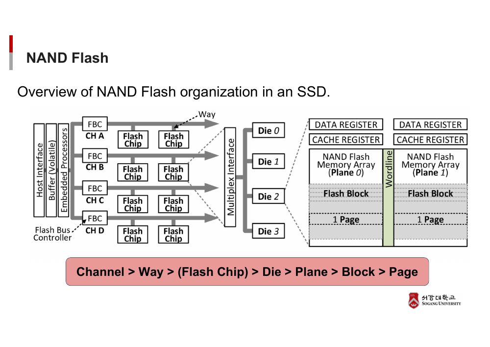 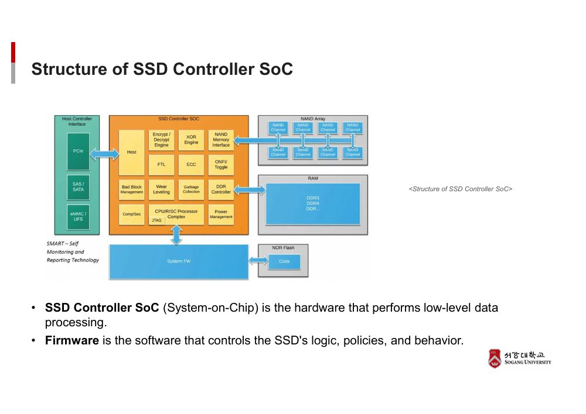<br/><sub>📄 강의자료 ② p.25 NAND 계층 / p.36 SSD Controller SoC 구조</sub></p>

### 4.2 🔥 SoC(하드웨어) vs Firmware(소프트웨어)

| | **SSD Controller SoC** | **SSD Firmware** |
|---|---|---|
| 정체 | **하드웨어 칩** | SoC 위에서 도는 **소프트웨어** |
| 역할 | **저수준** 데이터 처리: NAND 관리, **ECC**, **DMA**, DRAM 제어 | SSD의 **로직·정책·동작**: **FTL, wear leveling, GC, I/O 스케줄링**, 보안, 업데이트 |
| 구성 | ARM CPU, PCIe/NVMe 인터페이스, NAND 인터페이스, DMA, ECC | — |
| 업데이트 | 불가 | **가능** (기능 개선·버그 수정) |

**SoC 주요 기능 블록**

| 블록 | 하는 일 |
|---|---|
| Host Interface | PCIe/SATA/UFS 입력을 FTL을 거쳐 NAND로 (반대도) |
| Encrypt/Decrypt Engine | 암호화·복호화 |
| **XOR Engine** | XOR 연산 (데이터 zeroing, 에러 검출 등) |
| **ECC** | I/O 중 데이터 무결성 보장 |
| DDR Controller | DRAM과 데이터 교환 |
| Power Management | 전력 조절 |
| NAND Memory Interface | **ONFI**(표준, 외부 clock 필요, ONFI 3.2 최대 667 MT/s) 또는 **Toggle**(Toshiba·Samsung, DDR, clock 없음, Toggle 2.0 800 MT/s 이상) |

**Firmware 주요 기능**: FTL 실행(LBA → 물리 주소 mapping table) / I/O 스케줄링 / GC·WL 정책 / **TRIM·Flush 처리** / 펌웨어 업데이트
**둘의 협업**: 압축(쓰기 양↓ → NAND 수명↑), 보안(TCG Opal, secure erase — 하드웨어 내장 + 펌웨어가 키 관리)

### 4.3 🔥 Firmware 3계층: HIL → FTL → FIL

| 계층 | 하는 일 | 강의자료 포인트 |
|---|---|---|
| **HIL** (Host Interface Layer) | NVMe **SQ/CQ**(submission/completion queue)에서 요청을 **가져옴(fetch)** | ⚠️ fetch 단위가 **너무 크면** 한 queue가 다 차지 → **불공정(unfair)** / **너무 작으면** 공정하지만 **최대 대역폭을 못 씀** |
| **FTL** (Flash Translation Layer) | **Write buffering, Page allocation, Garbage collection** | 긴 쓰기 지연을 숨기려고 **DRAM에 버퍼링** → 버퍼가 꽉 차면 즉시 flush → **flush 동안 읽기가 크게 지연**될 수 있음 (flush 방식은 제품마다 다름: 용량/시간/읽기 기반) |
| **FIL** (Flash Interface Layer) | FTL 연산 → **실제 NAND 명령**으로 변환 | 여러 채널로 **inter/intra-channel 병렬성** 활용, chip의 read/program/erase 실패와 **ECC 성공/실패**를 FTL에 보고 |

**읽기 요청 8단계 (NVMe SSD)**
```
① Submit I/O request → ② Request transferred to SSD (HIL) → ③ FTL processing (주소 변환)
→ ④ Flash command transferred to chip → ⑤ Flash read 실행 → ⑥ Data transfer
→ ⑦ Post request completion → ⑧ Processing request completion
```
**데이터 흐름 (Cosmos+ OpenSSD 예)**: Host PC ─PCIe─ Host Interface(NVMe controller + DMA engine) → SoC(ARM CPU + DRAM) → NAND Flash Controller × N → NAND Die

<p align="center">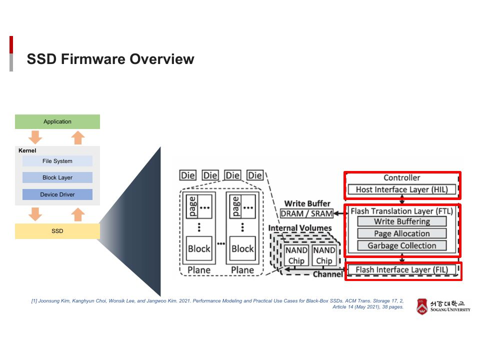 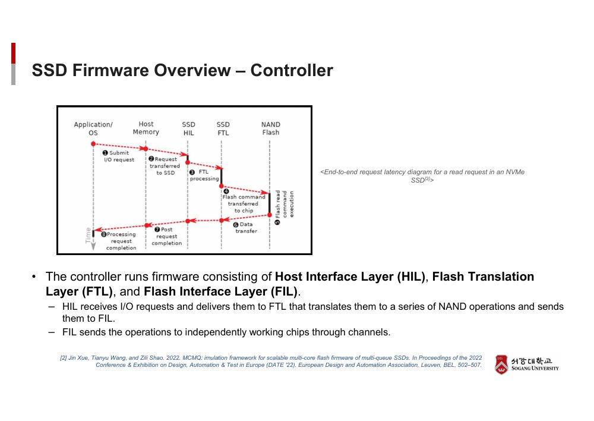<br/><sub>📄 강의자료 ② p.47 HIL·FTL·FIL / p.49 읽기 요청 8단계</sub></p>

### 4.4 Interface vs Protocol 🔥

- **Interface** = 물리·전기 연결 (SATA, SAS, **PCIe**) / **Protocol** = 명령 규약 (AHCI, SCSI, **NVMe**)
- ⚠️ SATA·SAS = interface **이자** protocol / **PCIe = interface, NVMe = 그 위의 protocol**

| | SATA | SAS | NVMe (PCIe) |
|---|---|---|---|
| 대상 | Consumer/Desktop | Enterprise/Datacenter | 현재 데이터센터 주력 |
| 링크 속도 | 6 Gb/s (SATA III) | 12 Gb/s (SAS-3) / 24 Gb/s (SAS-4) | lane 수 × 세대별 속도 |
| **Queue** | **1개 × depth 32** | depth **65,536** | **64K개 × depth 64K** |
| 대역폭 | ~600 MB/s | ~1.2–2.4 GB/s | 7–14 GB/s |
| 경로 | CPU → SATA 컨트롤러 → SSD | CPU → HBA → Expander → Drives | **CPU → PCIe → SSD** (컨트롤러 병목 제거) |
| 기타 | 지연 높음 | **Dual port**, SATA 드라이브도 연결 가능 | CPU core마다 SQ/CQ 쌍 → lock 경합 없음 |

- **SATA 세대**: SATA I 1.5 Gb/s(~150 MB/s) → **SATA II 3 Gb/s(~300 MB/s, NCQ 도입)** → SATA III 6 Gb/s(~600 MB/s)
- **eMMC vs UFS**: 둘 다 **NAND 기반, DRAM-less**, 임베디드용

| | eMMC | UFS |
|---|---|---|
| 신호 | **Parallel** (x8) — "느린 8차선" | **Serial** (LVDS, MIPI M-PHY + UniPro) — "빠른 1차선" |
| Duplex | **Half** (읽기·쓰기 동시 불가) | **Full** (전용 읽기·쓰기 경로) |
| Command queue | 없음 → **5.1에서 추가** | 기본 지원 (multi-queue) |
| 최대 속도 | ~400 MB/s (5.1) | **~4.2 GB/s (UFS 4.0)** |
| 용도 | 스마트워치, IoT, 저가폰 | 고급 스마트폰, 태블릿, 차량 |

- **버스 구조**: CPU의 IMC → **DDR 메모리 버스(채널당 25~70 GB/s, 서버 6~12채널)** / PCIe 컨트롤러 → GPU·**NVMe SSD 직결** / DMI → **PCH** → SATA SSD, USB, LAN (대역폭 공유)

**⭐ 대역폭 계산**
```
SATA III      : 6 Gb/s ÷ 8 = 750 MB/s → × 8/10 (8b/10b 인코딩, 20% 오버헤드) = 600 MB/s
PCIe          : GT/s × 128/130 × lane 수 ÷ 8
PCIe Gen3 x4  : 8 × 128/130 × 4 ÷ 8 ≈ 3.94 GB/s
PCIe Gen4 x4  : 16 × 128/130 × 4 ÷ 8 ≈ 7.88 GB/s
메모리 대역폭  : 채널당 대역폭 × 채널 수   (예: 50 GB/s × 12 = 600 GB/s)
```

<p align="center">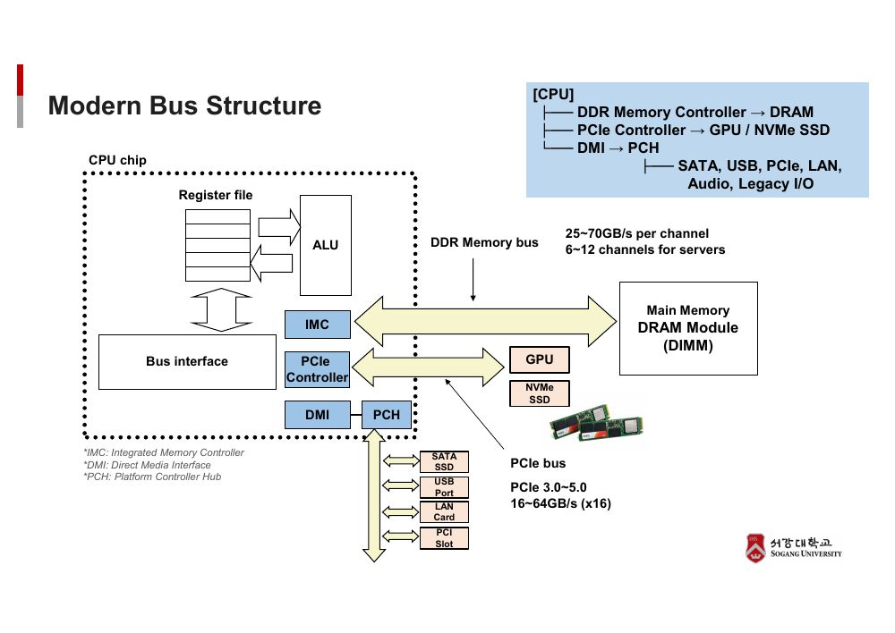<br/><sub>📄 강의자료 ② p.20 Modern Bus Structure (DDR · PCIe · DMI → PCH)</sub></p>

### 4.5 NAND 기초 🔥

**DRAM vs NAND**: DRAM은 gate 1개 + **capacitor**(64 ms마다 refresh, 전원 끄면 소멸) / NAND는 gate **2개**(control gate + **floating gate**) → 전원 꺼도 유지(**non-volatile**, 1~10년)

| 동작 | 방법 | 결과 | 단위 |
|---|---|---|---|
| **Program** | control gate에 고전압 → 전자가 floating gate에 갇힘 | 전자 많음 → **0** | **Page** |
| **Erase** | substrate에 고전압 → 전자를 빼냄 | 전자 적음 → **1** | **Block** |
| **Read** | 전자가 얼마나 있는지 센싱 | — | **Page** |

> 🔥 **비대칭**: **1 → 0 (program)은 page 단위로 골라서 가능** / **0 → 1 (erase)은 block 전체만 가능**
> - 판단법: **0→1로 바뀌는 비트가 하나라도 있으면 erase 필요** (F→5 가능, 5→F 불가)
> - 강의 그림: erase된 block은 **전부 1111**, program하면 일부가 0으로 (예: 1111 → 1001)
> - **Erase-before-write**: 이미 쓴 page는 block을 지우기 전에는 다시 쓸 수 없음
> - ⭐ **속도: Read < Write ⋘ Erase**

<p align="center">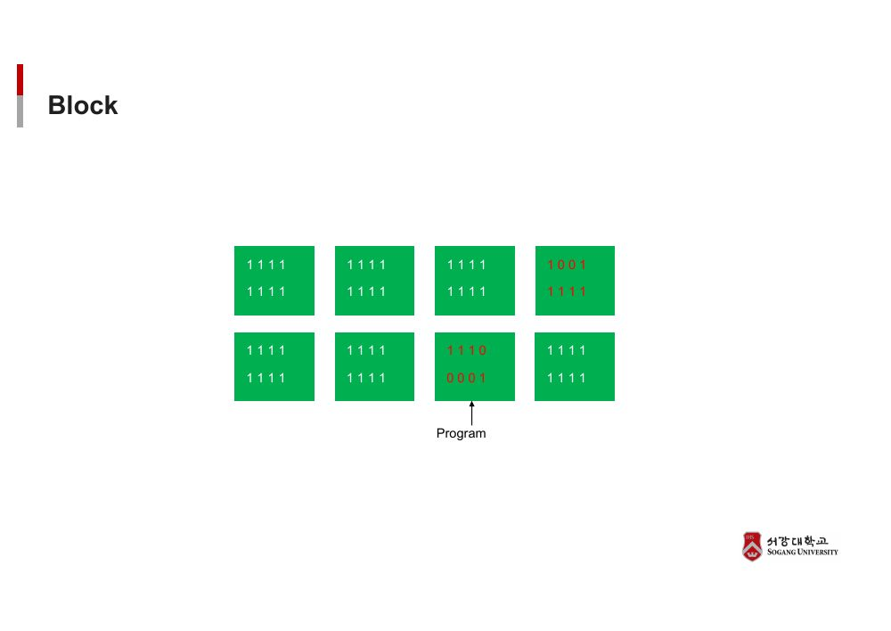 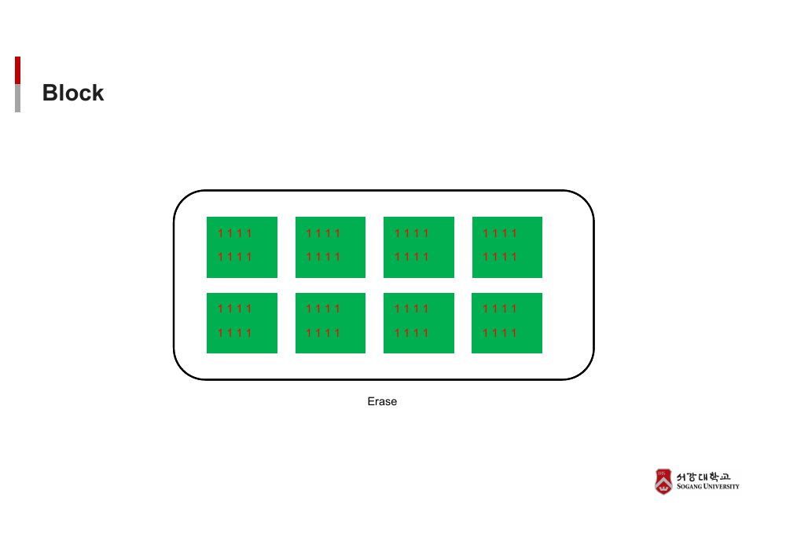<br/><sub>📄 강의자료 ② p.33 Program은 page 단위 (1→0) / p.34 Erase는 block 전체 (→ 1111)</sub></p>

**ISPP (Incremental Step Pulse Programming)**: Vth를 정밀하게 맞추려고 **Program 펄스 → Verify → Program 펄스 → Verify ...**를 반복. 전자를 넣으면 Vth가 올라가고, ⚠️ **한 번 올린 전압은 block 전체를 erase하지 않으면 내릴 수 없다.**

**Page/Block 크기 (강의자료 ②)**

| NAND | Page | Block당 page | Block |
|---|---|---|---|
| 예전 NAND | 4 KB | 128 | 512 KB |
| MLC | 8 KB | 256 | 2 MB |
| ⭐ 최신 TLC | **16 KB** | **256** | **4 MB** |
| 최신 QLC | 16–32 KB | 256–512 | 4–16 MB |

**동작 시간 (⚠️ 강의자료마다 숫자가 조금 다름 — 문제에 주어진 값을 쓸 것)**

| | ② NAND & SSD 자료 (read / program / erase) | ④ FTL 자료 (read / program / erase) |
|---|---|---|
| SLC | ~25 µs / 200–300 µs / 1.5–2 ms | 25–50 µs / 200–300 µs / 1.5–2 ms |
| MLC | ~50 µs / 600–900 µs / ~3 ms | 50–100 µs / 600–800 µs / 2–3 ms |
| TLC | 60–100 µs / 1.5–2 ms / 4–6 ms | 100–150 µs / 800–1200 µs / 3–4 ms |
| QLC | 80–150 µs / 3–5 ms / 6–8 ms | — |

**SLC → QLC** (셀당 1→4 bit, 상태 2→16개): 용량↑ 가격↓ / **쓰기 속도↓, 수명(P/E)↓, 에러↑** → 해결책: **SLC caching**, 펌웨어가 낮은 내구성과 높은 에러율을 보완

| P/E cycle | SLC | MLC | TLC | QLC |
|---|---|---|---|---|
| ② NAND & SSD 자료 (Micron 그림) | 100K | 10K | 3K | 1K |
| ④ FTL 자료 | ~100,000 | ~3,000 | ~1,000 | ~100–300 |

### 4.6 연습 문제

**Q1. 🔥** channel과 way를 설명하고, 내부 병렬성을 어떻게 만드는지 설명하라.
<sub>🇬🇧 Explain channel and way. How do they create internal parallelism?</sub>

<details>
<summary>▶ 답</summary>

- **Channel**: flash controller와 NAND chip 사이의 **독립 버스** → 채널끼리 **동시에** 전송
- **Way**: 한 채널을 공유하는 chip들 → 한 chip이 program 중일 때 다른 chip에 데이터를 보냄 (**interleaving**)
- 4 channel × 2 way면 chip 8개가 동시에 일함
</details>

**Q2. 🔥** SSD Controller SoC와 Firmware의 차이를 설명하라.
<sub>🇬🇧 Compare the SSD controller SoC and the SSD firmware.</sub>

<details>
<summary>▶ 답</summary>

- **SoC** = **하드웨어 칩**. ECC, DMA, NAND 관리, DRAM 제어 같은 **저수준 처리**
- **Firmware** = SoC 위에서 도는 **소프트웨어**. FTL, wear leveling, GC, I/O 스케줄링 같은 **정책·로직**. **업데이트 가능**
</details>

**Q3. 🔥** SSD 펌웨어 3계층과 역할을 쓰라.
<sub>🇬🇧 Name the three firmware layers of an SSD and their roles.</sub>

<details>
<summary>▶ 답</summary>

- **HIL**: NVMe submission/completion queue에서 요청을 가져옴
- **FTL**: 논리 → 물리 주소 변환, write buffering, page allocation, GC
- **FIL**: FTL 연산을 실제 NAND 명령으로 바꿔 채널로 보냄, 에러 상태 보고
</details>

**Q4.** HIL에서 fetch 단위가 너무 크거나 작으면 어떤 문제가 생기나?
<sub>🇬🇧 What happens if the request fetch unit in the HIL is too large or too small?</sub>

<details>
<summary>▶ 답</summary>

- **너무 크면**: 한 submission queue가 장치 I/O queue를 다 채워 **불공정(unfairness)**
- **너무 작으면**: 공정하지만 한 queue가 SSD의 **최대 대역폭을 못 씀**
</details>

**Q5.** SSD가 SATA에서 PCIe 기반 NVMe로 넘어간 이유는?
<sub>🇬🇧 Why did SSDs move from SATA to NVMe over PCIe?</sub>

<details>
<summary>▶ 답</summary>

SSD 내부 대역폭(여러 NAND die 병렬)이 SATA 한계 **600 MB/s**를 넘고, SATA(AHCI)는 **queue 1개 × 32**라 내부 병렬성을 못 쓴다. NVMe는 **64K queue**, PCIe는 **CPU에 직결**되어 컨트롤러 병목이 없다.
</details>

**Q6. (계산)** SATA III가 6 Gb/s인데 실효 대역폭이 600 MB/s인 이유를 계산으로 보여라.
<sub>🇬🇧 Show why SATA III (6 Gb/s) gives 600 MB/s of effective bandwidth.</sub>

<details>
<summary>▶ 답</summary>

```
6 Gb/s ÷ 8 = 750 MB/s   (bit → byte)
750 × 8/10 = 600 MB/s   (8b/10b 인코딩: 10 bit 보내서 8 bit만 데이터, 20% 오버헤드)
```
</details>

**Q7. 🔥** 0xC를 0x8로 바꿀 때 erase가 필요한가? 0x9 → 0xB는?
<sub>🇬🇧 Can a page storing 0xC be changed to 0x8 without erase? What about 0x9 → 0xB?</sub>

<details>
<summary>▶ 답</summary>

```
C = 1100 → 8 = 1000 : 1→0만 있음 → program만으로 가능 (erase 불필요)
9 = 1001 → B = 1011 : 0→1이 하나 있음 → erase 필요
```
</details>

**Q8. (계산)** TLC NAND가 page 16 KB, block당 256 page다. block 크기는? QLC가 page 32 KB, block당 512 page라면?
<sub>🇬🇧 Calculate the block size for TLC (16 KB × 256) and QLC (32 KB × 512).</sub>

<details>
<summary>▶ 답</summary>

```
TLC: 16 KB × 256 = 4,096 KB = 4 MB
QLC: 32 KB × 512 = 16,384 KB = 16 MB
```
page·block이 커질수록 작은 데이터를 고쳐도 큰 단위로 움직여야 해서 관리가 어려워진다.
</details>

**Q9.** eMMC가 parallel인데도 serial인 UFS보다 느린 이유는?
<sub>🇬🇧 Why is eMMC (parallel) slower than UFS (serial)?</sub>

<details>
<summary>▶ 답</summary>

eMMC는 **half-duplex**(읽기·쓰기 동시 불가)이고 command queue가 원래 없어 명령을 하나씩 처리한다. 병렬 선은 clock을 올리면 신호가 어긋나서(skew) 고속화가 어렵다. UFS는 **full-duplex serial**(전용 읽기·쓰기 경로) + **command queue**.
</details>

<br/>

---

## 블록 5. FTL — 주소 변환 "제대로 이해하기" (45분) 🔥🔥

> 📄 강의자료 ④ (NAND Flash Management — Flash Translation Layer) 전체
> 교수님이 **"제대로 이해하기"**라고 강조한 부분. 순서대로: **왜 필요? → 어떻게 동작? → 손으로 trace → 계산 → 서술**. **5.5와 5.6은 반드시 손으로 표를 그려서** 푸세요.

### 5.1 🔥 왜 FTL이 필요한가 — 3단 논리 (서술형 단골)

```
① 불일치   FS가 아는 건 read sector / write sector(덮어쓰기) 2개뿐
           ↔ Flash는 read / program / erase, 덮어쓰기 없음      ("Not same as flash")
② 순진한 방법 그대로 덮어쓰면 Read-Modify-Write
           → block 전체 읽기 → 수정 → erase → 다시 쓰기  = 6.6 ms + write amplification
③ 해결      FS와 Flash 사이에 copy-on-write 계층을 두고,
           논리 주소 → 물리 주소로 변환 = FTL (Flash Translation Layer)
```

> ⭐ **핵심 문장 3개 (그대로 외워 쓰기)**
> 1. *"The file system assumes overwrite, but flash cannot overwrite a page without erasing the whole block."*
>    FS는 덮어쓰기를 가정하지만, flash는 block 전체를 지우지 않고는 page를 덮어쓸 수 없다.
> 2. *"The FTL writes new data to a free page and updates the mapping table to point to the new physical page."*
>    FTL은 새 데이터를 빈 page에 쓰고, mapping table이 새 물리 page를 가리키게 바꾼다.
> 3. *"Because of the mapping table, the SSD looks like a normal disk."* (강의자료: **"SSD: looks like disk"**)
>    mapping table 덕분에 FS 입장에서 SSD는 그냥 디스크처럼 보인다.

### 5.2 🔥 순진한 방식: Read-Modify-Write 계산 (강의자료 그대로)

상황: FS가 Block 0의 첫 page(`0000`)를 **`0001`로 바꾸려 함**. Block = 4 page, **MLC 보수적 수치** (read 100 µs, program 800 µs, erase 3 ms)

```
① 4 Page Read      : 4 × 100 µs = 400 µs   ← block의 page를 전부 DRAM으로 (read all other pages in block)
② DRAM에서 수정     : ≈ 0 (negligible)      ← 그 page만 0001로
③ 1 Block Erase    : 3 ms                  ← block 0 전체가 1111로
④ 4 Page Program   : 4 × 800 µs = 3.2 ms   ← DRAM의 4 page를 다시 씀
───────────────────────────────────────────
   Total Latency   : 6.6 ms   ← page 하나 바꾸는 데 HDD 랜덤 쓰기 수준!
```

> 🔥 **Write Amplification** (강의자료): *"Writing one 16 KB page may cause read, erase, and program of a 4 MB block."*
> ```
> WAF = NAND에 실제로 쓴 양 ÷ 호스트가 쓰라고 한 양      (위 예: 4 page ÷ 1 page = 4)
> ```
> WAF가 크면 → **느려지고 + P/E 수명이 빨리 닳는다.** 원인: **RMW**, **GC의 valid page 복사**

<p align="center">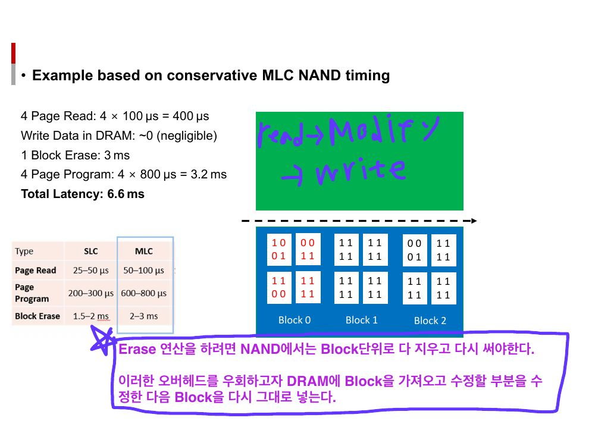<br/><sub>📄 강의자료 ④ p.15 RMW Total Latency 6.6 ms</sub></p>

### 5.3 🔥 해결책: Copy-on-Write + 주소 변환

| | In-place update | Out-of-place update (COW) |
|---|---|---|
| 동작 | **그 자리에서** 값을 바꿈 | **다른 자리에 쓰고 주소를 바꿈** |
| 사용처 | HDD | **Flash** |

**강의자료 예시 "Write New, Discard Old"**: A=12, B=5 상태에서 `Write(A, 10)`, `Write(B, 7)`
```
before:  [ 12 ][ 5 ][    ][    ]        A → 12, B → 5
after:   [ 12 ][ 5 ][ 10 ][ 7  ]        A → 10, B → 7   (12, 5는 버려짐 = garbage)
          회색(옛것)   새로 씀
"But, metadata management is required."  ← 주소가 바뀌었으니 누군가 기억해야 함
```

**⚠️ 왜 FS에 새 주소를 알려주지 않나?** → 디바이스가 FS의 파일 관리에 거꾸로 끼어들게 되어 **계층 분리가 깨진다**. 그래서 **SSD 안에 mapping table**을 두고, FS는 예전 주소 그대로 쓰게 한다.

**강의자료 예시 "Copy-on-Write and Address Translation"**: 논리 page 1에 `1101`을 쓰라는 요청
```
Logical :   0      1      2      3      4 ...
            │      │       ╲      ╲
Physical: [0001] [0010] [0011] [0000] [1001] [1111] [1111] [1111]
                   ↑ 옛 page                    ↑ 빈 page
쓰기 후:
Logical 1 ──────────────────────────────────▶ [1101]  (빈 page에 새로 씀)
Physical [0010] → 아무도 안 가리킴 → "must eventually be garbage collected"
가운데 표 → "Address translation needs to be managed"  (= mapping table, 필기: Indexer)
```

**COW의 대가 3가지** 🔥
1. **Garbage** 발생 → 나중에 **GC**로 회수해야 함
2. **Page 상태 관리** 필요 (어느 page가 쓰레기인지 표시)
3. **Mapping table 관리** → SSD 내부 **SRAM/DRAM**에 상주, **잃어버리면 데이터 위치를 모름**

<p align="center">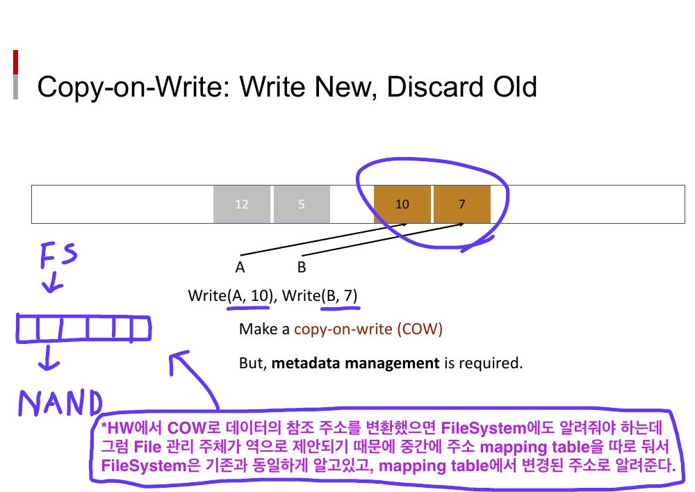 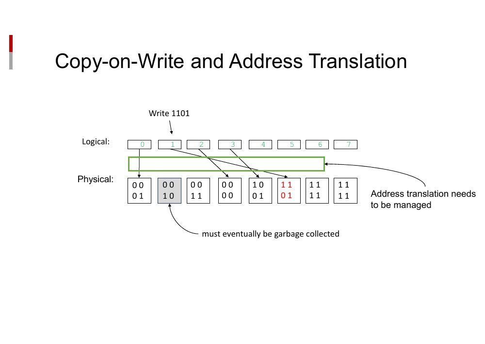<br/><sub>📄 강의자료 ④ p.18 COW + mapping table 필기 / p.21 Address translation</sub></p>

### 5.4 ⭐ FTL 정리 (강의자료 "Flash Translation Layer" 슬라이드)

- SSD **내부 펌웨어**로 구현, SSD 내부 **CPU** 위에서 동작
- **3대 기능**: ① **Address Translation** ② **Garbage Collection** ③ **Wear-Leveling**
- **Mapping은 어디에?** → **SSD 내부 SRAM 또는 DRAM**
- **물리 page의 3가지 상태**: **Valid, Invalid, Free**

```
              program
   ┌──────┐ ─────────▶ ┌───────┐
   │ free │            │ valid │
   └──────┘ ◀──┐       └───────┘
       ▲       │           │  relocate (같은 논리 주소를 다른 곳에 새로 씀)
       │ erase │           │  또는 TRIM
       │(block)│           ▼
       │       │      ┌─────────┐
       └───────┴───── │ invalid │
                      └─────────┘
```
> ⚠️ **invalid → free는 block 단위 erase로만 가능** (page 하나만 free로 못 만듦) ← T/F 단골

**용어**: **LPN**(논리 page 번호, FS가 보는 주소, 강의 예 100·101·2000) / **PPN**(물리 page 번호, 강의 예 00~11) / **mapping table**(LPN → PPN)

**⭐ FTL 동작 규칙 (trace 문제는 이 규칙대로 풀면 됨)**
```
읽기(LPN):    PPN = table[LPN]  →  그 물리 page를 읽음

쓰기(LPN):    ① 다음 빈 page(free)에 순서대로 program
             ② 이 LPN의 옛 page가 있으면 → invalid로 표시
             ③ table[LPN] = 새 page,  새 page = valid

TRIM(LPN):   그 LPN의 page → invalid (더 이상 안 쓴다고 OS가 알려줌)

GC:          ① garbage가 있는 victim block 고르기
             ② victim의 valid page 읽기
             ③ 다른 빈 page에 쓰기 + table 갱신   ← 호스트가 안 시킨 쓰기 = write amplification
             ④ victim block 전체 erase → 전부 free
```

**⭐ Static vs Dynamic mapping** (③ RAID 자료와 연결)

| | Static mapping | Dynamic mapping |
|---|---|---|
| 방식 | 간단한 수식 (`A % N`) | 자료구조 (hash table, tree, 표) |
| 예 | **RAID** | **page table, SSD FTL** |
| 장점 | 빠름, 하드웨어로 구현 쉬움 | 유연함 |
| 단점 | 위치가 고정 | 메모리·CPU 소모 |

> FTL이 dynamic이어야 하는 이유: COW는 **같은 논리 주소의 물리 위치가 쓸 때마다 바뀌므로** 수식으로 표현할 수 없다.

<p align="center">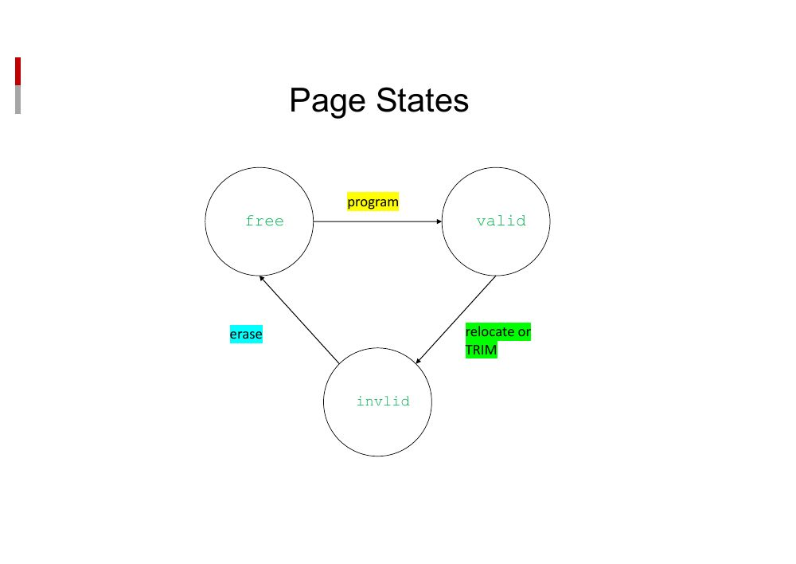<br/><sub>📄 강의자료 ④ p.23 Page States (free → valid → invalid → free)</sub></p>

### 5.5 🔥 강의 예제 Trace — "Writes on an SSD" + GC (강의자료 p.25~29)

조건: page **4 KiB**, **block = 4 page**, Block 0~2 (PPN 00~11). **처음엔 모든 page가 INVALID(i)**.
요청: `Write(100)=a1, Write(101)=a2, Write(2000)=b1, Write(2001)=b2` (100·2000 = 논리 page 번호)

**① Block 0 erase** → 00~03이 E(erased, 쓸 수 있음)
```
Block:   |------ 0 ------|------ 1 ------|------ 2 ------|
Page:     00  01  02  03  04  05  06  07  08  09  10  11
State:    E   E   E   E   i   i   i   i   i   i   i   i
```

**② 순서대로 program + mapping 갱신** → **③ 4번 쓰기 후**
```
Table:   100→0   101→1   2000→2   2001→3                (Memory)
Page:     00  01  02  03  04  05  06  07  08  09  10  11
Content:  a1  a2  b1  b2                                 (Flash)
State:    V   V   V   V   i   i   i   i   i   i   i   i
```
> ⭐ 논리 번호가 100이든 2000이든 **물리적으로는 빈 page에 순서대로** 쓴다 → **랜덤 쓰기가 순차 쓰기로 바뀐다**

<p align="center">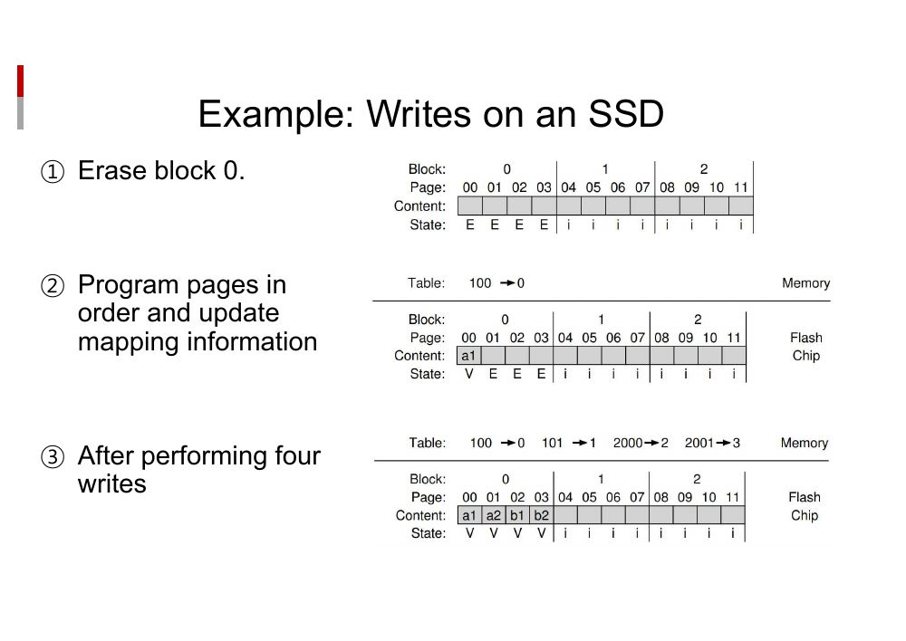<br/><sub>📄 강의자료 ④ p.26 Writes on an SSD ①②③</sub></p>

**④ 업데이트: `Write(100)=c1, Write(101)=c2`** (Block 1 erase 후 사용)
```
Table:   100→4   101→5   2000→2   2001→3
Page:     00  01  02  03  04  05  06  07  08 ...
Content:  a1  a2  b1  b2  c1  c2
State:    ✗   ✗   V   V   V   V   E   E   i ...
          └ Garbage ┘
```
- 00, 01(a1, a2)은 옛 버전 = **garbage** → 새 쓰기를 위해 회수해야 함
- ⚠️ 강의자료 그림엔 00, 01이 V로 남아 있지만, **mapping table에서 아무도 안 가리키므로 사실상 invalid**

<p align="center">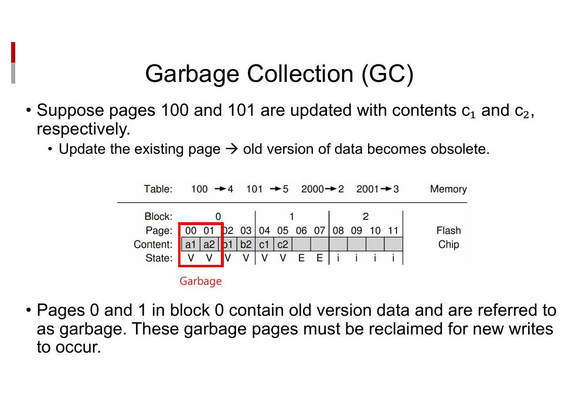<br/><sub>📄 강의자료 ④ p.27 Garbage (00, 01)</sub></p>

**⑤ GC (강의자료 4단계 그대로)**
```
① Find a block that contains one or more garbage pages.  → victim = Block 0
② Read the live (non-garbage) pages from that block.       → b1(02), b2(03)
③ Write those live pages to the next available writable pages.  → b1→06, b2→07
④ Reclaim the entire block for future writes.              → Block 0 erase

Table:   100→4   101→5   2000→6   2001→7
Page:     00  01  02  03  04  05  06  07
Content:                  c1  c2  b1  b2
State:    E   E   E   E   V   V   V   V
```
**이 예제의 WAF (응용)**: 호스트가 쓴 page = 6 (a1, a2, b1, b2, c1, c2), NAND에 쓴 page = 6 + GC 복사 2 = 8 → **WAF = 8/6 ≈ 1.33**

**강의자료 GC Process 그림 요약**
```
① 기존 데이터 업데이트 요청
② 빈 page에 새 데이터 저장, 옛 page는 Invalid
③ 반복되면 Block A, B에 Invalid가 쌓이고 free block이 부족해짐
④ A, B의 Valid page만 모아서 빈 Block C로 복사
⑤ map table 갱신 후 A, B를 erase → A, B가 다시 빈 block
```
> ⭐ GC를 하려면 복사 받을 **빈 block이 항상 최소 하나** 있어야 한다.

<p align="center">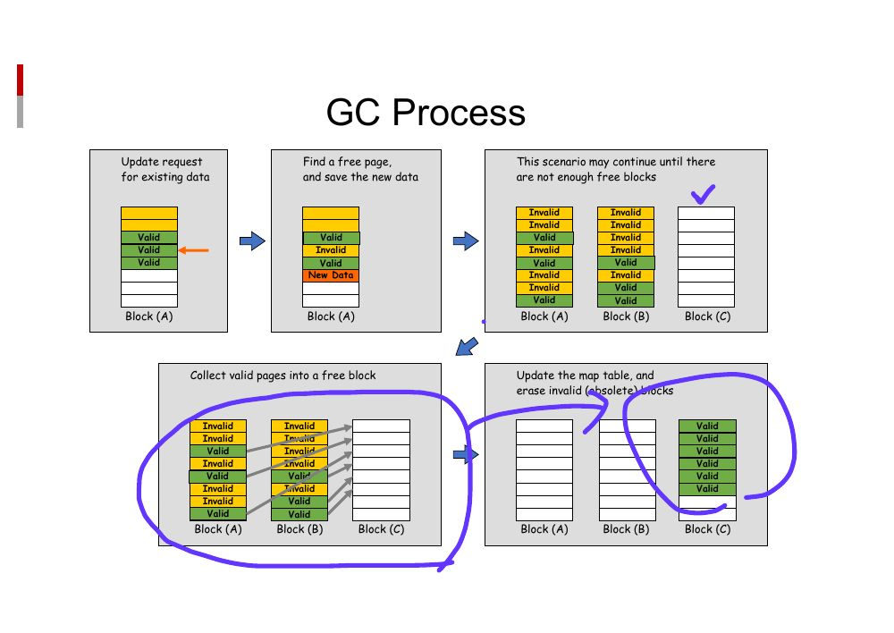<br/><sub>📄 강의자료 ④ p.29 GC Process</sub></p>

### 5.6 🔥🔥 직접 해보는 Trace 문제 (가장 중요)

**Q1.** SSD에 **block 3개**(Block 0, 1, 2), **block당 4 page**(PPN 0~11)가 있고 모두 erase 상태다. FTL은 **page 단위 mapping**을 쓰고, 빈 page에 **순서대로**(PPN 0, 1, 2, ...) 쓴다. 호스트 요청:
<sub>🇬🇧 An SSD has 3 blocks with 4 pages each (PPN 0–11), all erased. The FTL uses page-level mapping and writes to the next free page in order. The host sends:</sub>

```
W(0)=A,  W(1)=B,  W(2)=C,  W(0)=A',  W(3)=D,  W(1)=B',  W(4)=E,  W(0)=A''
```

- (a) 최종 mapping table을 쓰라. <sub>Show the final mapping table.</sub>
- (b) 각 물리 page의 상태(Valid / Invalid / Free)를 쓰라. <sub>Show the state of each physical page.</sub>
- (c) 지금 **Greedy** GC를 돌리면 victim은? 결과를 보여라. <sub>GC runs with the Greedy policy. Which block is the victim?</sub>
- (d) GC를 포함한 WAF를 구하라. <sub>Calculate the WAF including GC.</sub>
- (e) GC 전에 **TRIM(2)**가 왔다면 무엇이 달라지나? <sub>What changes if TRIM(2) arrives before GC?</sub>

<details>
<summary>▶ 답</summary>

**진행 과정**

| 요청 | 쓰는 PPN | Table 변화 | invalid가 되는 PPN |
|---|---|---|---|
| W(0)=A | 0 | 0→0 | — |
| W(1)=B | 1 | 1→1 | — |
| W(2)=C | 2 | 2→2 | — |
| W(0)=A' | 3 | 0→3 | **0** (A) |
| W(3)=D | 4 | 3→4 | — |
| W(1)=B' | 5 | 1→5 | **1** (B) |
| W(4)=E | 6 | 4→6 | — |
| W(0)=A'' | 7 | 0→7 | **3** (A') |

**(a) 최종 mapping table**
```
LPN:  0   1   2   3   4
PPN:  7   5   2   4   6
```

**(b) page 상태**
```
           |----- Block 0 -----|----- Block 1 -----|----- Block 2 -----|
PPN:          0    1    2    3    4    5    6    7    8    9   10   11
Content:      A    B    C    A'   D    B'   E    A''
State:        I    I    V    I    V    V    V    V    F    F    F    F
```
Block 0: valid 1개 / Block 1: valid 4개 / Block 2: 비어 있음

**(c) Greedy GC** → victim = **Block 0** (valid가 가장 적음: 1개)
```
① victim = Block 0
② valid page 읽기: C (PPN 2)
③ C를 PPN 8에 쓰기 → table: 2→8
④ Block 0 erase → PPN 0~3 free

Table:  0→7  1→5  2→8  3→4  4→6
State:  Block 0 = F F F F | Block 1 = V V V V | Block 2 = V F F F
```

**(d) WAF**
```
호스트가 쓴 양 = 8 page
NAND에 쓴 양  = 8 + 1 (GC로 C 복사) = 9 page
WAF = 9 ÷ 8 = 1.125
```

**(e) GC 전에 TRIM(2)**: PPN 2가 **invalid**가 되어 Block 0의 valid가 **0개** → 복사 없이 **erase만** → NAND 쓰기 8, **WAF = 1.0**. TRIM은 쓸모없는 데이터의 복사를 막는다.
</details>

**Q2.** Q1 (c) 이후에 호스트가 `R(2)`를 보내면 어느 물리 page를 읽나? FS는 왜 몰라도 되나?
<sub>🇬🇧 After (c), the host sends R(2). Which physical page is read? Why does the FS not need to know?</sub>

<details>
<summary>▶ 답</summary>

FTL이 mapping table에서 **LPN 2 → PPN 8**을 찾아 PPN 8을 읽는다. FS는 여전히 논리 주소 2만 쓰고, GC 때 물리 위치가 PPN 2 → 8로 바뀐 건 **FTL만 안다** → 계층 분리 유지.
</details>

**Q3.** 왜 GC를 위해 빈 block이 최소 하나는 항상 있어야 하나?
<sub>🇬🇧 Why must at least one free block always be kept for GC?</sub>

<details>
<summary>▶ 답</summary>

GC는 victim을 erase하기 **전에** valid page를 다른 빈 곳에 복사해야 한다. 빈 block이 없으면 **복사할 곳이 없어 GC를 못 한다.**
</details>

### 5.7 Mapping table 크기 & 매핑 단위

```
엔트리 수 = SSD 용량 ÷ page 크기
표 크기   = 엔트리 수 × 엔트리 크기

1 TB, 4 KB page, 4 B 엔트리: 2⁴⁰ ÷ 2¹² = 2²⁸ 개 × 4 B = 2³⁰ B = 1 GB
→ ⭐ "SSD 1 TB당 DRAM 1 GB" 경험칙
```
- 강의자료 ② 실제 제품 예: SK hynix Platinum P51 **1 TB**에 **DDR4 1 GB** — 경험칙과 일치
- UFS·eMMC는 **DRAM-less** → mapping table을 둘 DRAM이 없음 (UFS는 HPB로 호스트 DRAM을 빌려 보완)

**Q4. (계산)** **4 TB** SSD, page **16 KB**, 엔트리 **4 B**, page 단위 mapping이면 DRAM이 얼마나 필요한가?
<sub>🇬🇧 A 4 TB SSD uses page-level mapping with 16 KB pages and 4 B entries. How much DRAM is needed?</sub>

<details>
<summary>▶ 답</summary>

```
엔트리 수 = 4 TB ÷ 16 KB = 2⁴² ÷ 2¹⁴ = 2²⁸ ≈ 2.7억 개
표 크기   = 2²⁸ × 4 B = 2³⁰ B = 1 GB
```
page가 클수록 엔트리 수가 줄어 표가 작아진다. (4 KB page였다면 2³⁰ × 4 B = 4 GB)
</details>

**표를 줄이는 방법** — 강의에서는 이름만 언급 (Block / Hybrid / DFTL). 아래는 이해용 보충입니다.

| 방식 | 아이디어 | 장점 | 단점 |
|---|---|---|---|
| **Page 단위** | page마다 엔트리 1개 | 아무 page에나 쓸 수 있어 유연 | **표가 큼** (1 TB당 ~1 GB) |
| **Block 단위** | block마다 엔트리 1개, block 안 위치는 고정 | 표가 매우 작음 (1 TB ÷ 4 MB = 2¹⁸ × 4 B = 1 MB) | page 하나만 바꿔도 **block을 통째로 옮겨야** 함 |
| **Hybrid** | 대부분 block 단위, 일부 로그 block만 page 단위 | 절충 | 구현 복잡 |
| **DFTL** | 전체 표는 flash에, **자주 쓰는 것만 DRAM에 캐싱** | DRAM 절약 | 캐시 miss 시 flash에서 읽어야 함 |

### 5.8 TRIM 🔥

- 파일을 지워도 FS는 **자기 메타데이터만** 바꿈 → SSD는 그 page가 여전히 **valid**라고 생각
- **TRIM** = OS가 SSD에 **"이 논리 주소는 더 이상 안 쓴다"**고 알려주는 명령 → page가 **invalid** → GC 때 쓸데없이 복사 안 함
- ⚠️ **HDD는 TRIM이 필요 없다** (그냥 덮어쓰면 되니까)
- 강의자료: 펌웨어 기능 중 **"TRIM/Flush Handling"**, 상태 전이도의 **valid → invalid ("relocate or TRIM")**, eMMC 4.41부터 **TRIM 지원**

### 5.9 Garbage Collection 🔥

> ⭐ 강의자료 "GC Summary"
> - **GC is expensive** — live(valid) 데이터를 **읽고 다시 써야** 함
> - **Ideal case** — **전부 dead(invalid)**인 block을 회수 (복사 없이 erase만)
> - **Cost** — **옮겨야 할 valid 데이터 양**에 달림
> - **완화 1: Over-provisioning** — 보이는 용량보다 flash를 더 탑재 (예: 1 TB NAND, 960 GB 노출) → 더 오래 기다릴 수 있어 victim의 valid page↓
> - **완화 2: Background GC** — 사용자 I/O(foreground)에 영향이 적도록 뒤에서 실행

```
GC 시간 (victim에 valid page k개) = k × (read + program) + erase
예) MLC, k = 1:  1 × (100 + 800) µs + 3 ms = 3.9 ms
    MLC, k = 0:  3 ms (erase만)
```

| Victim 선택 | 기준 | 특징 |
|---|---|---|
| **Greedy** | **valid page가 가장 적은** block | 당장 복사 비용 최소. 단점: 곧 바뀔 **hot** data를 복사할 수 있음 |
| **Cost-Benefit** | `(1 − u) × age ÷ 2u`가 가장 큰 block | **age**를 고려 → 오래된 **cold** block 우선 |

```
u = block의 valid 비율 (0~1),  1 − u = 회수할 빈 공간,  2u = valid를 읽고(u) 쓰는(u) 비용,  age = 마지막 수정 후 지난 시간
```
- **GC 시점** (강의 구두 설명): **Reactive** = free block이 임계치 아래로 떨어지면 → 사용자 요청 중이면 지연이 튐 / **Proactive** = idle을 **예측**해서 미리 (독립 변수: 요청 간격·free block 수·쓰기 패턴 → 종속 변수: GC 시점)

**Q5. (Cost-Benefit)** Block X: u = 0.2, age = 10. Block Y: u = 0.5, age = 50. Greedy와 Cost-Benefit은 각각 어느 block을 고르나?
<sub>🇬🇧 Which block does Greedy pick? Which does Cost-Benefit pick?</sub>

<details>
<summary>▶ 답</summary>

```
Greedy:       valid가 가장 적음 → X (u = 0.2)
Cost-Benefit: X = (1 − 0.2) × 10 ÷ (2 × 0.2) = 8 ÷ 0.4 = 20
              Y = (1 − 0.5) × 50 ÷ (2 × 0.5) = 25 ÷ 1.0 = 25   → Y
```
Y는 valid가 많지만 오래돼서(cold) 앞으로도 안 바뀔 가능성이 크다. X는 최근에 쓴 hot block이라 기다리면 공짜로 더 invalid가 된다.
</details>

**Q6. (GC 비용)** MLC (read 100 µs, program 800 µs, erase 3 ms), block당 4 page. valid가 3개인 victim과 0개인 victim의 GC 시간을 비교하라.
<sub>🇬🇧 Compare the GC time of a victim with 3 valid pages and one with 0 valid pages.</sub>

<details>
<summary>▶ 답</summary>

```
valid 3개: 3 × (100 + 800) µs + 3 ms = 2.7 + 3 = 5.7 ms   (+ NAND 쓰기 3개 추가 → WAF↑)
valid 0개: 3 ms (erase만)
```
그래서 block이 거의 다 invalid가 될 때까지 기다리는 게 좋고, over-provisioning과 TRIM이 도움이 된다.
</details>

### 5.10 Wear Leveling · Bad Block · Read Disturb

**NAND Endurance** = 셀이 신뢰성을 잃기 전까지 견디는 **P/E 횟수**. P/E할 때마다 셀의 **oxide layer(산화막)**가 조금씩 손상 → 비트 에러, read disturb

| 기법 | 내용 |
|---|---|
| **Wear leveling** | P/E를 **모든 block에 고르게** 분산 → 특정 block이 먼저 수명 한계에 도달하지 않게 |
| └ **Dynamic** | **자주 쓰는(frequently written) block** 대상 — 새 쓰기를 덜 닳은 빈 block에 |
| └ **Static** | 거의 안 쓰는(underused) block의 **cold data를 가끔 옮김** → 그 block도 쓰기에 참여 |
| **Bad block 관리** | 제조 때부터 불량 + 쓰다가 고장(**runtime**) → **OOB(Out-of-Band) 영역**에 표시, **spare block**으로 대체 |
| **Read disturb** | 한 block을 **반복해서 읽기만 해도** 주변 셀에 에러 |
| **Data refresh** | 취약한 block의 데이터를 **주기적으로 새 block에 다시 씀** → 에러 누적 방지 |

<p align="center">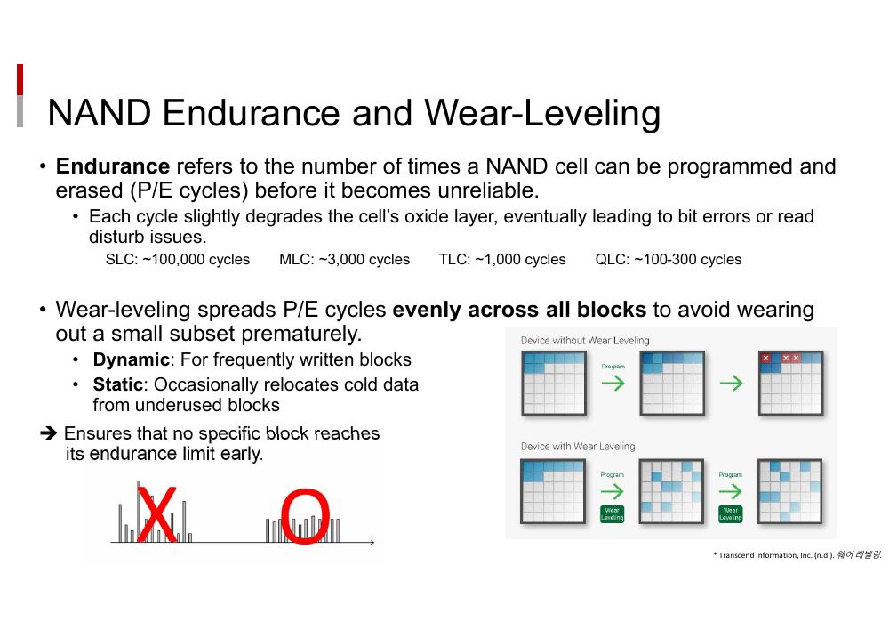<br/><sub>📄 강의자료 ④ p.32 Endurance & Wear-Leveling</sub></p>

### 5.11 영어 서술 연습

**Q7. 🔥** FTL이 Read-Modify-Write를 어떻게 피하는지, 그 대가는 무엇인지 설명하라.
<sub>🇬🇧 Explain how the FTL avoids read-modify-write. What are the costs?</sub>

<details>
<summary>▶ 답</summary>

**copy-on-write(out-of-place update)**: 새 데이터를 **빈 page에 쓰고** mapping table이 새 물리 page를 가리키게 바꾼다. 옛 page는 invalid.
대가: ① garbage → **GC 필요** ② **page 상태 관리** ③ **mapping table**에 DRAM 필요, 잃으면 안 됨
</details>

**Q8. 🔥** FTL은 dynamic mapping, RAID는 static mapping을 쓰는 이유는?
<sub>🇬🇧 Why does the FTL use dynamic mapping while RAID uses static mapping?</sub>

<details>
<summary>▶ 답</summary>

RAID는 논리 블록의 물리 위치가 **고정**이라 간단한 수식(A % N)이면 충분하고 하드웨어로 빠르다. SSD는 COW 때문에 **쓸 때마다 물리 위치가 바뀌어** 표로 기억해야 한다.
</details>

**Q9.** page 단위 FTL은 어떻게 랜덤 쓰기를 순차 쓰기로 바꾸나?
<sub>🇬🇧 How does a page-mapped FTL turn random writes into sequential writes?</sub>

<details>
<summary>▶ 답</summary>

논리 주소가 100이든 2000이든 상관없이 **다음 빈 page에 순서대로** 쓰고 table만 바꾸므로, 논리적 랜덤 쓰기가 **물리적 순차 쓰기**가 된다.
</details>

**Q10. 🔥** write amplification을 정의하고 주요 원인 2가지를 쓰라.
<sub>🇬🇧 What is write amplification, and what are its two main causes?</sub>

<details>
<summary>▶ 답</summary>

호스트가 요청한 것보다 NAND에 **더 많이 쓰는** 현상. **WAF = NAND 쓰기 ÷ 호스트 쓰기.**
원인: ① **RMW** (page 하나 바꾸려고 block 전체를 다시 씀) ② **GC의 valid page 복사**
결과: 성능↓, 수명↓
</details>

**Q11. 🔥 (계산: RMW vs COW)** TLC NAND: page read **100 µs**, page program **1.5 ms**, block erase **4 ms**, block당 **256 page**. page 1개를 (a) RMW로 갱신할 때와 (b) FTL(COW)로 갱신할 때의 지연과 WAF를 구하라.
<sub>🇬🇧 TLC NAND: read 100 µs, program 1.5 ms, erase 4 ms, 256 pages per block. Compare the latency and WAF of updating one page with (a) read-modify-write and (b) the FTL (copy-on-write).</sub>

<details>
<summary>▶ 답</summary>

```
(a) RMW:  Read 256 page    = 256 × 0.1 ms = 25.6 ms
          Erase 1 block    = 4 ms
          Program 256 page = 256 × 1.5 ms = 384 ms
          Total            ≈ 413.6 ms,     WAF = 256 ÷ 1 = 256

(b) COW:  빈 page에 1개만 program = 1.5 ms,  mapping table 갱신(DRAM, ≈0)
          Total ≈ 1.5 ms,                   WAF = 1  (GC 전까지)
```
block이 클수록 RMW는 감당 불가 → 그래서 FTL이 필요하다. 대신 COW는 garbage가 쌓여 **나중에 GC 비용**을 낸다.
</details>

**Q12. (계산: GC 포함 WAF)** 호스트가 page **1,000개**를 썼고, 그동안 GC가 victim block들에서 valid page **250개**를 옮겼다. WAF는?
<sub>🇬🇧 The host wrote 1,000 pages, and GC copied 250 valid pages. What is the WAF?</sub>

<details>
<summary>▶ 답</summary>

```
WAF = NAND 쓰기 ÷ 호스트 쓰기 = (1,000 + 250) ÷ 1,000 = 1.25
```
GC가 옮기는 valid page가 많을수록 WAF↑ → over-provisioning, TRIM, 좋은 victim 선택(Greedy/Cost-Benefit)으로 줄인다.
</details>

<br/>

---

## 블록 6. 서술형 대비 — 질문 20개 + 답안 키워드 (15분) 🔥

> 왼쪽 질문만 보고 **키워드를 넣어 3~4줄로 말해 보세요.** 키워드가 다 들어가면 만점 답안입니다. 막히면 오른쪽 블록으로 돌아가세요.

### HDD

| # | 질문 | 답안에 꼭 넣을 키워드 | 블록 |
|---|---|---|---|
| 1 | 🔥 HDD에서 랜덤 I/O가 순차보다 훨씬 느린 이유는? | 요청마다 **seek + rotation**(ms) / transfer는 µs / 순차는 seek·rotation **한 번만** → **50~90배** | 1.2 |
| 2 | 🔥 HDD 성능 개선 기법 3가지(Other Improvements)를 설명하라 | **Track skew**(settle 시간 확보) / **Zones**(바깥 track에 sector↑, 바깥이 빠름) / **Cache**(read-ahead, write caching, TCQ) | 2.1 |
| 3 | write caching(immediate reporting)의 장점과 위험은? | DRAM에 넣고 바로 ACK → **빠름** / **정전 시 손실** → **consistency 깨짐** | 2.1 |
| 4 | 🔥 OS는 왜 SPTF를 못 쓰고 SSTF를 쓰나? | SPTF는 **회전 위치** 필요 / OS는 **LBA만** 앎 / 디스크만 geometry 앎 / SSTF = seek만 | 2.3 |
| 5 | SCAN과 C-SCAN을 비교하라 | SCAN: **왕복**, 가운데 cylinder 유리 / C-SCAN: **한 방향**, 더 **공정** / 둘 다 starvation 없음 | 2.3 |
| 6 | HAMR, MAMR, SMR을 비교하라 | HAMR **레이저 가열**(밀도 최고, 제조 어려움) / MAMR **마이크로파**(공정 호환) / SMR **track 겹침**(순차 쓰기만, 아카이브) | 2.4 |

### RAID

| # | 질문 | 답안에 꼭 넣을 키워드 | 블록 |
|---|---|---|---|
| 7 | 🔥 RAID-4의 랜덤 쓰기가 R/2인 이유와 RAID-5의 해결법은? | small write = **I/O 4개**(subtractive parity) / 2개가 **단일 parity 디스크** → **병목**, N 무관 / RAID-5는 parity **rotate** → **N·R/4** | 3.5 |
| 8 | 🔥 RAID-1과 RAID-5를 워크로드별로 비교하라 | 랜덤 쓰기: RAID-1 (N/2)·R vs RAID-5 N·R/4 → **RAID-1이 2배** / 순차: (N−1)·S > (N/2)·S → **RAID-5** / 용량은 RAID-5가 큼 | 3.3, 3.6 |
| 9 | 디스크를 늘려도 latency가 줄지 않는 이유는? | 요청 하나는 **디스크 1개**가 처리 / seek·rotation 그대로 / 늘어나는 건 **병렬 처리량(throughput)** | 3.4 |
| 10 | RAID-1의 consistent-update 문제와 해결법은? | 두 디스크 쓰기 중 **crash** → 사본 불일치, 어느 쪽이 맞는지 모름 / **H/W RAID: NVRAM** / S/W RAID는 불가 | 3.6 |
| 11 | RAID-6의 특징과 두 번째 parity가 XOR이 아닌 이유는? | parity **2개 rotate**, **2개 고장** 허용, (N−2)·C / 둘 다 XOR이면 **같은 방정식** → **Reed-Solomon** | 3.5 |

### SSD 구조

| # | 질문 | 답안에 꼭 넣을 키워드 | 블록 |
|---|---|---|---|
| 12 | 🔥 SSD 내부 구조(계층)와 병렬성을 설명하라 | **Channel > Way > Chip > Die > Plane > Block > Page** / channel 동시 전송 / way **interleaving** / **plane 단위** 병렬 | 4.1 |
| 13 | 🔥 SSD Controller SoC와 Firmware를 비교하라 | SoC = **하드웨어**, 저수준(**ECC, DMA**, NAND·DRAM 제어) / Firmware = **소프트웨어**, 정책(**FTL, GC, WL**), **업데이트 가능** | 4.2 |
| 14 | 🔥 펌웨어 3계층(HIL·FTL·FIL)의 역할은? | **HIL**: NVMe **SQ/CQ**에서 fetch / **FTL**: 주소 변환, write buffering, page allocation, GC / **FIL**: NAND 명령 변환, 채널 병렬, 에러 보고 | 4.3 |
| 15 | SSD가 SATA에서 NVMe로 넘어간 이유는? | 내부 대역폭 > **SATA 600 MB/s** / AHCI **1 × 32 queue** / NVMe **64K × 64K**, PCIe **CPU 직결** | 4.4 |
| 16 | 🔥 NAND의 program/erase 비대칭과 erase-before-write를 설명하라 | program **1→0, page** / erase **0→1, block** / 덮어쓰기 불가 → block 지우고 다시 / **read < program ⋘ erase** | 4.5 |
| 17 | SLC → QLC로 갈 때의 trade-off는? | 셀당 bit↑ → **용량↑ 가격↓** / 상태 간격 좁아짐 → **속도↓, 에러↑, P/E↓** / 보완: **SLC caching**, 펌웨어 | 4.5 |

### FTL

| # | 질문 | 답안에 꼭 넣을 키워드 | 블록 |
|---|---|---|---|
| 18 | 🔥🔥 FTL이 왜 필요하고 어떻게 주소 변환을 하는지 설명하라 | FS는 **read/write sector(덮어쓰기)** 가정 ↔ flash는 **read/program/erase** / 그대로면 **RMW**(6.6 ms) + **write amplification** / **COW**: 빈 page에 쓰고 **mapping table**(LPN→PPN, SRAM/DRAM) 갱신 / 옛 page **invalid** / **"SSD looks like disk"** | 5.1~5.4 |
| 19 | 🔥🔥 GC 과정과 비용, 비용을 줄이는 방법은? | ① victim 선택 ② **valid page 읽기** ③ **다른 곳에 쓰기 + table 갱신** ④ **block erase** / 비용 = **옮길 valid 양** / **over-provisioning, background GC**, TRIM, Greedy·Cost-Benefit | 5.5, 5.9 |
| 20 | 🔥 TRIM, wear leveling, read disturb를 각각 설명하라 | TRIM: OS가 **안 쓰는 LPN** 알림 → invalid → GC 복사↓ (HDD는 불필요) / WL: P/E **고르게**, **dynamic**(자주 쓰는 block) vs **static**(cold data 이동) / Read disturb: **반복 읽기**로 주변 셀 에러 → **data refresh** | 5.8, 5.10 |

<br/>

---

## 블록 7. True / False 60문항 (25분) 🔥

> 시험에는 영어 문장으로 나오고 **T/F만 고르면 됩니다**(이유 X). 정답표의 "이유"는 공부용입니다. ⭐ = 특히 나오기 쉬운 문항.

### 7.1 HDD (1~18)

1. ⭐ 7,200 RPM 디스크의 평균 회전 지연은 약 8.3 ms다.
   <sub>The average rotational delay of a 7,200 RPM disk is about 8.3 ms.</sub>
2. ⭐ HDD 랜덤 I/O에서는 보통 전송 시간이 전체 시간을 지배한다.
   <sub>For random I/O on an HDD, transfer time usually dominates the total I/O time.</sub>
3. 평균 seek 거리는 최대 seek 거리의 약 1/3이다.
   <sub>The average seek distance is about one third of the maximum seek distance.</sub>
4. seek는 accelerate, coast, decelerate, settle 단계를 거친다.
   <sub>A seek must accelerate, coast, decelerate, and settle.</sub>
5. settle 단계만 0.5~2 ms가 걸릴 수 있다.
   <sub>Settling alone can take 0.5–2 ms.</sub>
6. 디스크는 sector에 대해 read, write, delete 연산을 제공한다.
   <sub>A disk provides read, write, and delete operations on sectors.</sub>
7. ⭐ track skew는 순차 읽기가 다음 track으로 넘어갈 때 헤드가 settle할 시간을 준다.
   <sub>Track skew gives the head enough time to settle when sequential reads move to the next track.</sub>
8. ⭐ ZBR에서는 안쪽 track이 바깥 track보다 sector가 더 많다.
   <sub>In zoned bit recording, inner tracks have more sectors than outer tracks.</sub>
9. ZBR에서 바깥 zone의 순차 전송률이 더 높다.
   <sub>With ZBR, outer zones have a higher sequential transfer rate.</sub>
10. ⭐ immediate reporting에서는 호스트가 ACK를 받은 후에도 정전 시 데이터가 손실될 수 있다.
    <sub>With immediate reporting, data can be lost on power failure even after the host receives an ACK.</sub>
11. read-ahead(track buffer)는 회전 대기 동안 track 전체를 메모리에 읽어 둔다.
    <sub>Read-ahead reads the entire track into memory during rotational delay.</sub>
12. ⭐ OS는 논리 블록 주소를 알기 때문에 SPTF를 구현할 수 있다.
    <sub>The OS can implement SPTF because it knows the logical block addresses.</sub>
13. SSTF와 SPTF 모두 멀리 있는 요청에 starvation을 일으킬 수 있다.
    <sub>Both SSTF and SPTF can cause starvation of far-away requests.</sub>
14. SCAN은 가운데 cylinder를 가장자리보다 자주 서비스한다.
    <sub>SCAN serves middle cylinders more often than edge cylinders.</sub>
15. C-SCAN은 양방향으로 sweep한다.
    <sub>C-SCAN sweeps in both directions.</sub>
16. TCQ는 디스크가 여러 대기 요청의 순서를 바꾸게 해 준다.
    <sub>Tagged command queueing lets the disk reorder multiple outstanding requests.</sub>
17. SMR 드라이브는 빠른 랜덤 쓰기를 제공한다.
    <sub>SMR drives provide fast random writes.</sub>
18. bad sector를 spare sector로 재매핑하면 `df`에 보이는 용량이 줄어든다.
    <sub>When bad sectors are remapped to spare sectors, the capacity shown by df decreases.</sub>

<details>
<summary>▶ 답 (1~18)</summary>

| # | 답 | 이유 |
|---|---|---|
| 1 | **F** | 8.3 ms는 **1회전**. 평균은 절반 **≈ 4.2 ms** |
| 2 | **F** | **seek와 rotation**이 지배. 전송은 µs |
| 3 | **T** | |
| 4 | **T** | |
| 5 | **T** | |
| 6 | **F** | **read와 write만** 있음. delete 없음 |
| 7 | **T** | |
| 8 | **F** | **바깥** track이 sector가 더 많음 |
| 9 | **T** | |
| 10 | **T** | |
| 11 | **T** | |
| 12 | **F** | OS는 **회전 위치**를 모름 → SSTF 사용 |
| 13 | **T** | |
| 14 | **T** | |
| 15 | **F** | C-SCAN은 **한 방향**만 |
| 16 | **T** | |
| 17 | **F** | SMR은 zone 안에서 **순차 쓰기만** |
| 18 | **F** | 재매핑은 디스크 안에서 처리 → `df` 크기 **안 변함** |
</details>

### 7.2 RAID (19~31)

19. ⭐ RAID-0에 디스크를 추가하면 요청 하나의 latency가 줄어든다.
    <sub>Adding more disks to RAID-0 reduces the latency of a single request.</sub>
20. RAID-0은 디스크 1개 고장을 견딜 수 있다.
    <sub>RAID-0 can tolerate one disk failure.</sub>
21. RAID-1의 랜덤 읽기 처리량은 N·R이다.
    <sub>The random read throughput of RAID-1 is N·R.</sub>
22. ⭐ RAID-4의 랜덤 쓰기 처리량은 N이 늘면 증가한다.
    <sub>The random write throughput of RAID-4 increases as N increases.</sub>
23. RAID-5의 랜덤 쓰기 처리량은 N·R/4다.
    <sub>The random write throughput of RAID-5 is N·R/4.</sub>
24. ⭐ RAID-5 small write는 I/O 4개가 필요하므로 latency가 4D다.
    <sub>The latency of a small write in RAID-5 is 4D because it needs four I/Os.</sub>
25. ⭐ 랜덤 쓰기 위주 워크로드에서는 RAID-5가 RAID-1보다 낫다.
    <sub>RAID-5 is better than RAID-1 for random-write-heavy workloads.</sub>
26. RAID-5는 RAID-4보다 모든 면에서 같거나 낫다.
    <sub>RAID-5 is strictly better than RAID-4.</sub>
27. RAID-6은 두 parity 모두 XOR을 쓴다.
    <sub>RAID-6 uses XOR for both of its parities.</sub>
28. ⭐ RAID는 static mapping, SSD FTL은 dynamic mapping을 쓴다.
    <sub>RAID uses static mapping, while the SSD FTL uses dynamic mapping.</sub>
29. fail-stop 모델은 silent data corruption을 감지할 수 있다.
    <sub>The fail-stop model can detect silent data corruption.</sub>
30. 소프트웨어 RAID(Linux md)는 NVRAM으로 consistent-update 문제를 해결한다.
    <sub>Software RAID (Linux md) solves the consistent-update problem with NVRAM.</sub>
31. subtractive parity는 N과 상관없이 I/O 4개가 필요하다.
    <sub>Subtractive parity needs four I/Os regardless of N.</sub>

<details>
<summary>▶ 답 (19~31)</summary>

| # | 답 | 이유 |
|---|---|---|
| 19 | **F** | 디스크를 늘리면 **throughput**만 좋아지고 **latency는 그대로(D)** |
| 20 | **F** | RAID-0은 **0개** |
| 21 | **T** | 아무 복사본이나 읽으면 됨 |
| 22 | **F** | 단일 parity 디스크 때문에 **R/2로 고정** |
| 23 | **T** | |
| 24 | **F** | latency는 **2D** (읽기 2개 병렬 → 쓰기 2개 병렬) |
| 25 | **F** | **RAID-1**이 2배 빠름: (N/2)·R vs N·R/4 |
| 26 | **T** | 강의자료 문장 그대로 |
| 27 | **F** | P = XOR, Q = **Reed-Solomon** |
| 28 | **T** | |
| 29 | **F** | fail-stop은 디스크 전체 고장만. silent corruption은 **checksum** 필요 |
| 30 | **F** | **하드웨어** RAID가 NVRAM 사용. S/W RAID는 이 방법이 없음 |
| 31 | **T** | read D_old, read P_old, write D_new, write P_new |
</details>

### 7.3 SSD Architecture (32~47)

32. ⭐ NVMe는 interface이고 PCIe는 그 위에서 도는 protocol이다.
    <sub>NVMe is an interface, and PCIe is the protocol that runs on it.</sub>
33. SATA(AHCI)는 최대 64K개의 queue를 지원한다.
    <sub>SATA (AHCI) supports up to 64K queues.</sub>
34. SATA III의 실효 대역폭은 8b/10b 인코딩 때문에 600 MB/s다.
    <sub>The effective bandwidth of SATA III is 600 MB/s because of 8b/10b encoding.</sub>
35. eMMC는 parallel bus를 쓰기 때문에 UFS보다 빠르다.
    <sub>eMMC is faster than UFS because it uses a parallel bus.</sub>
36. eMMC와 UFS는 모두 NAND 기반이고 DRAM-less다.
    <sub>Both eMMC and UFS are NAND-based and DRAM-less.</sub>
37. ⭐ NAND cell을 program하면 비트가 0에서 1로 바뀐다.
    <sub>Programming a NAND cell changes its bit from 0 to 1.</sub>
38. ⭐ erase는 page 단위로 수행된다.
    <sub>Erase is performed in page units.</sub>
39. 0xA(1010)를 0x8(1000)로 바꾸려면 erase가 필요하다.
    <sub>Changing 0xA (1010) to 0x8 (1000) requires an erase.</sub>
40. read, write, erase 중 erase가 가장 느리다.
    <sub>Read latency < write latency <<< erase latency.</sub>
41. ⭐ 셀당 bit 수가 늘면 P/E cycle 한도가 늘어난다.
    <sub>As the number of bits per cell increases, the P/E cycle limit increases.</sub>
42. ISPP에서 한 번 program으로 올린 전압은 block을 erase하지 않으면 내릴 수 없다.
    <sub>In ISPP, once programmed, the voltage cannot be decreased without erasing the entire block.</sub>
43. way는 한 channel을 공유하는 chip들의 인터페이스다.
    <sub>A way is the interface of each NAND chip sharing one channel.</sub>
44. NAND flash chip은 plane 단위로 I/O를 병렬 처리한다.
    <sub>A NAND flash chip performs I/O requests in parallel at plane granularity.</sub>
45. ⭐ FTL, wear leveling, GC는 SSD controller SoC 하드웨어가 아니라 펌웨어의 기능이다.
    <sub>FTL, wear leveling, and GC are implemented by the SSD firmware, not by the SoC hardware.</sub>
46. HIL의 fetch 단위가 너무 작으면 불공정(unfairness)이 생긴다.
    <sub>If the HIL fetch unit is too small, it causes unfairness.</sub>
47. FTL의 쓰기 버퍼를 flush하는 동안 읽기가 크게 지연될 수 있다.
    <sub>During the buffer-flush period, read operations can be significantly delayed.</sub>

<details>
<summary>▶ 답 (32~47)</summary>

| # | 답 | 이유 |
|---|---|---|
| 32 | **F** | 반대: **PCIe = interface, NVMe = protocol** |
| 33 | **F** | AHCI는 **1 queue × 32**. 64K queue는 NVMe |
| 34 | **T** | 6 Gb/s ÷ 8 × 0.8 = 600 MB/s |
| 35 | **F** | **UFS**(serial, full-duplex, CQ)가 더 빠름 |
| 36 | **T** | 강의자료 문장 |
| 37 | **F** | program = **1 → 0**, erase = 0 → 1 |
| 38 | **F** | erase는 **block** 단위 |
| 39 | **F** | 1→0만 바뀌므로 **program만** |
| 40 | **T** | |
| 41 | **F** | P/E는 **줄어든다** (SLC ~100K → QLC ~100–1K) |
| 42 | **T** | |
| 43 | **T** | |
| 44 | **T** | |
| 45 | **T** | 강의자료 SoC vs Firmware 표 |
| 46 | **F** | 너무 **크면** 불공정. 너무 작으면 대역폭을 못 씀 |
| 47 | **T** | |
</details>

### 7.4 FTL (48~60)

48. FTL은 out-of-place update를 한다.
    <sub>The FTL performs out-of-place updates.</sub>
49. ⭐ invalid page는 page 하나만 erase해서 free로 만들 수 있다.
    <sub>An invalid page can be erased individually and become free.</sub>
50. TRIM은 SSD뿐 아니라 HDD에도 필요하다.
    <sub>TRIM is needed for HDDs as well as SSDs.</sub>
51. ⭐ Greedy GC는 valid page가 가장 많은 block을 고른다.
    <sub>The Greedy GC policy selects the block with the most valid pages.</sub>
52. over-provisioning은 GC 비용을 높인다.
    <sub>Over-provisioning increases garbage collection cost.</sub>
53. ⭐ copy-on-write에서 FTL은 파일시스템에 새 물리 주소를 알려 준다.
    <sub>With copy-on-write, the FTL notifies the file system of the new physical address.</sub>
54. GC는 valid page를 복사해 넣을 빈 block이 최소 하나 필요하다.
    <sub>GC requires at least one free block to copy valid pages into.</sub>
55. read disturb는 block에 쓰기가 없어도 에러를 일으킬 수 있다.
    <sub>Read disturb can cause errors even if the block is never written.</sub>
56. ⭐ 1 TB SSD, 4 KB page, 4 B 엔트리의 page 단위 mapping table은 약 1 GB DRAM이 필요하다.
    <sub>A page-level mapping table for a 1 TB SSD with 4 KB pages and 4 B entries needs about 1 GB of DRAM.</sub>
57. mapping table은 SSD 내부 SRAM 또는 DRAM에 저장된다.
    <sub>The mapping table is stored in SRAM or DRAM inside the SSD.</sub>
58. GC의 가장 이상적인 경우는 valid page로만 가득 찬 block을 회수하는 것이다.
    <sub>The ideal GC case is reclaiming a block that contains only valid pages.</sub>
59. static wear leveling은 거의 쓰지 않는 block의 cold data를 가끔 옮긴다.
    <sub>Static wear leveling occasionally relocates cold data from underused blocks.</sub>
60. bad block은 OOB 영역에 표시되고 데이터는 spare block으로 옮겨진다.
    <sub>Bad blocks are flagged in the OOB area, and data is redirected to spare blocks.</sub>

<details>
<summary>▶ 답 (48~60)</summary>

| # | 답 | 이유 |
|---|---|---|
| 48 | **T** | |
| 49 | **F** | invalid → free는 **block** erase로만 |
| 50 | **F** | HDD는 덮어쓰기가 되므로 필요 없음 |
| 51 | **F** | Greedy는 valid가 **가장 적은** block |
| 52 | **F** | GC 비용을 **낮춘다** (victim에 invalid가 더 많이 쌓임) |
| 53 | **F** | FTL은 **mapping table**로 숨김. FS는 논리 주소만 봄 |
| 54 | **T** | |
| 55 | **T** | → data refresh로 해결 |
| 56 | **T** | 2²⁸ × 4 B = 1 GB |
| 57 | **T** | 강의자료 "Where to store mapping? SRAM or DRAM inside an SSD" |
| 58 | **F** | 이상적인 건 **전부 invalid(dead)**인 block (복사할 게 없음) |
| 59 | **T** | |
| 60 | **T** | |
</details>

<br/>

---

## 블록 8. 시험 직전 5분 — 백지 체크

| # | 질문 | 답 |
|---|---|---|
| 1 | 평균 회전 지연? | ½ × 60,000 ÷ RPM (ms) — 7,200 → 4.2, 10,000 → 3, 15,000 → 2 |
| 2 | HDD I/O 시간 / 대역폭? | seek + rotation + transfer / 크기 ÷ 시간 |
| 3 | 평균 seek 거리? | 최대의 1/3 |
| 4 | Other Improvements 3종? | Track skew, Zones, Cache |
| 5 | OS가 SPTF 못 하는 이유? | 회전 위치를 모름 → SSTF |
| 6 | RAID-4 / RAID-5 랜덤 쓰기? | R/2 / N·R/4 |
| 7 | RAID-1 랜덤 읽기 / 쓰기? | N·R / (N/2)·R |
| 8 | RAID-5 쓰기 지연? | 2D (I/O는 4개) |
| 9 | Subtractive parity? | P_new = P_old ⊕ D_old ⊕ D_new |
| 10 | Interface vs Protocol? | PCIe = interface, NVMe = protocol |
| 11 | SATA / NVMe queue? | 1 × 32 / 64K × 64K |
| 12 | Program / Erase? | 1→0 page 단위 / 0→1 block 단위 |
| 13 | NAND 계층? | Channel > Way > Chip > Die > Plane > Block > Page |
| 14 | 펌웨어 3계층? | HIL → FTL → FIL |
| 15 | FTL 3대 기능? | Address translation, GC, Wear leveling |
| 16 | 물리 page 3상태? | Valid, Invalid, Free (invalid → free는 block erase로만) |
| 17 | WAF? | NAND 쓰기 ÷ 호스트 쓰기 |
| 18 | RMW 예제 시간? | 400 µs + 3 ms + 3.2 ms = 6.6 ms |
| 19 | GC 4단계? | victim 찾기 → valid 읽기 → 다른 곳에 쓰기 → block erase |
| 20 | Mapping table 크기? | 용량 ÷ page × 엔트리 (1 TB당 ~1 GB) |

<br/>

---

> ⚠️ **참고 사항**
> - **강의자료와 대조해 고친 점**: SAS queue depth를 강의자료 ②의 **65,536**으로 수정 (이전 판은 수업 노트 기준 ~254), SAS-4 속도 **24 Gb/s**. ISPP, HIL fetch 단위, FTL 버퍼 flush, FIL 에러 보고, SoC 기능 블록, ONFI/Toggle, plane 단위 병렬성, eMMC/UFS DRAM-less 등 강의자료에만 있던 내용을 추가했습니다.
> - **강의자료끼리 숫자가 다른 부분**: NAND 동작 시간과 P/E cycle은 자료 ②와 ④가 다릅니다(블록 4.5 표). **문제에 숫자가 주어지면 그 숫자를 쓰세요.**
> - **"응용"·"보충"으로 표시한 부분**(HDD 평균 응답 시간, track skew sector 수, trace 예제의 WAF, Block/Hybrid/DFTL 설명)은 강의 공식·개념을 확장한 연습이며, 슬라이드에 같은 숫자가 있는 것은 아닙니다.
> - Cost-Benefit 공식, Reactive/Proactive GC, Reed-Solomon, RAID-6 쓰기 I/O 6개는 슬라이드가 아니라 **수업 중 구두 설명**(수업 노트) 기준입니다.
